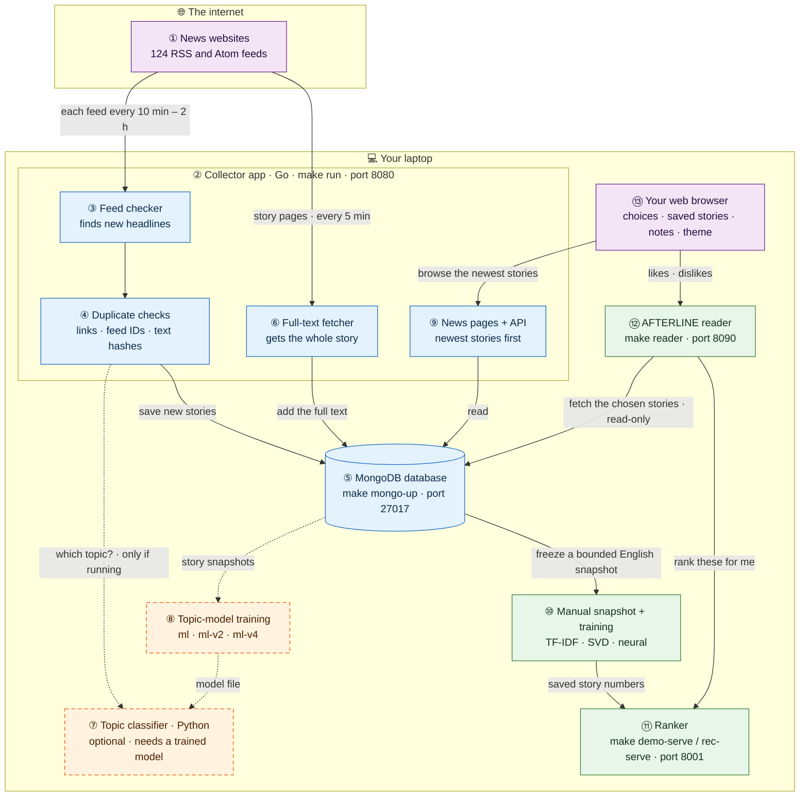
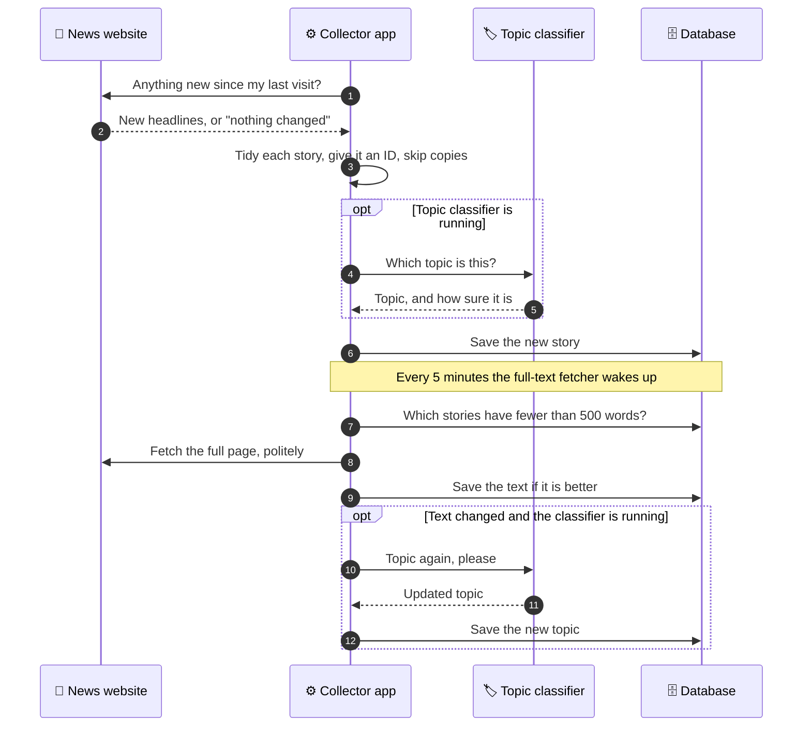
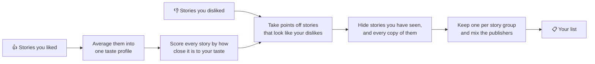
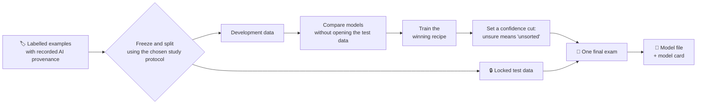

# news-bot

**Your own news robot.** news-bot collects articles from 124 configured news feeds, checks for duplicates, can sort articles by topic, and suggests what to read next in **AFTERLINE**. You can run it on your own laptop or home server.

[](LICENSE)


**Status reviewed 25 November 2026:** the collector and a local AFTERLINE demo are implemented.
The demo has Fresh, Yesterday and Archive views, professional-source filtering, saved
stories with notes, and light/dark themes. It is not the finished, hosted private service.
See the [progress checklist](docs/project/recommender-client-review.md#project-progress-checklist)
and [roadmap](docs/project/roadmap.md) for recorded evidence and unfinished release work.

## Contents

1. [What is this?](#1-what-is-this)
2. [What you get](#2-what-you-get)
3. [The big picture](#3-the-big-picture)
4. [Try it on your laptop](#4-try-it-on-your-laptop)
5. [How it works](#5-how-it-works)
6. [Project map](#6-project-map)
7. [Command cheat sheet](#7-command-cheat-sheet)
8. [How to contribute](#8-how-to-contribute)
9. [Known limits](#9-known-limits)
10. [Words you'll see](#10-words-youll-see)
11. [License](#11-license)

## 1. What is this?

Keeping up with the news takes time. You visit lots of websites, see the same story again and again, and still miss things you would have enjoyed.

news-bot does the boring part for you:

- 🗞️ **It collects.** It polls 124 configured RSS and Atom feeds, with database checks for duplicate links, feed IDs and text hashes. Several feeds can belong to one publisher.
- 🏷️ **It can sort.** A topic classifier can file each story under one of 13 topics, such as technology, health or sport.
- ✨ **It suggests.** In AFTERLINE you pick a few stories you like, and it finds more like them, including older ones you missed.

The feed list leans toward **software, data science and AI**, plus general news from India, the US, the UK and a few other countries.

It keeps a few promises:

- **English reading selections.** The recommendation snapshot filters for English text. Collection itself does not reject every non-English article; language detection and cleaning depend on the optional classifier sidecar.
- **Free to run.** Nothing needs a paid service.
- **Browser-local choices.** AFTERLINE keeps likes, saved stories, notes and settings in your browser, not in an account. They do not sync across devices.
- **Polite to websites.** When it fetches a full article, it follows the site's robots.txt rules and waits between visits.

It's also a good way to learn how a real data project fits together: Go programs, a MongoDB database and Python machine learning.

## 2. What you get

| Part | What it does | Works today? |
| --- | --- | --- |
| News collector | Polls 124 configured RSS and Atom feeds, with duplicate checks and collection history | ✅ Yes; configured feeds are not a guarantee that every publisher is reachable |
| Full-text fetcher | Tries to extract readable text when a feed sends only a teaser; follows robots rules and retry limits | ✅ Yes; paywalls and blocked pages can remain short |
| News pages and API | Shows the newest stories in your browser, and lets programs ask for feeds, stories and history | ✅ Yes |
| AFTERLINE reader | Grid front page, full-screen reading, related stories, likes/dislikes and three reading methods | ✅ Local demo, after you build a snapshot ([Part B](#part-b--get-suggestions-with-afterline)) |
| Fresh, Yesterday and Archive | Verified dates up to 30 days old, a short India-time daily selection, and older/unverified stories | ✅ Local demo; manually refreshed snapshots, not a live index or stored daily edition |
| Reader controls | Professional-source filter, saved stories with notes, and a system-aware light/dark switch | ✅ In one browser; saved stories/notes and settings survive snapshot changes |
| Article information | Publication-date provenance, revision/write timestamps, sidecar cleaning/language results and resumable backfill | ✅ Implemented and tested; production backfill/deployment verification remains open |
| Topic classifier | Files articles under 1 of 13 topics, or "unsorted" when confidence is low | ⚠️ Serves the V4 model (owner-approved, D19) from a private bundle that is not distributed by cloning this repo; deployment is not confirmed until the bundle is on the production volume |
| Training tools | Legacy classifier studies, the V4 classifier trainer, and TF-IDF/SVD/neural recommendation comparisons | ✅ Available; Human-labelled classifier scores are human validation |

**Still needed for the full private service:**

- Sign-in for a small group of invited readers
- Account-backed saved stories, saved topics and notes that follow you across devices
- Adding your own RSS feeds from the reader
- Full topic/source and professional/local/city settings, beyond the demo's professional-source switch
- Stored daily editions for each account, beyond the demo's calculated Yesterday view
- Follow-up stories, and suggestions for topics you haven't picked yet
- New stories ready to suggest within an hour of being collected
- The planned improved recommendation model and the final human reading study; today's content-based suggestions already use your likes and dislikes
- A read-only MCP server (MCP is a standard way for AI assistants to use tools), so an AI assistant can search the news
- Later still: a spoken briefing sized to the time you have, and an iPhone app

## 3. The big picture

Each number in the picture matches a row in the key below it.



**Colours:** purple is the outside world and you, blue is the collector, green is AFTERLINE, and dashed orange is optional. Dotted arrows lead to or from an optional part. The picture's source is [`docs/assets/system-overview.mmd`](docs/assets/system-overview.mmd).

| # | Part | What it does |
| --- | --- | --- |
| ① | News websites | Many news sites publish a **feed**: a list of their newest stories that computers can read (RSS or Atom). The 124 feeds are listed in [`collector/configs/sources.yaml`](collector/configs/sources.yaml). |
| ② | Collector app | The main Go program. When it starts, it prepares the database and loads the feed list. Then it runs the jobs inside this box, side by side, until you stop it. |
| ③ | Feed checker | Every minute it looks for feeds that are due. Each feed has its own timer, from every 10 minutes to every 2 hours. |
| ④ | Duplicate checks | Checks normalised/canonical links, feed IDs and text fingerprints. Different publishers' versions can still be stored; the recommender groups likely copies separately. |
| ⑤ | MongoDB database | Stores the feeds, the stories and a log of every feed check. It runs inside Docker. |
| ⑥ | Full-text fetcher | Many feeds send only a teaser. Every 5 minutes it fetches the full page for stories with fewer than 500 words, slowly and politely. |
| ⑦ | Topic classifier | A small Python web service. It files a story under 1 of 13 topics, or says "unsorted" when it isn't sure. It needs a trained model file. |
| ⑧ | Topic-model training | Tools that teach the classifier from example stories that already have topics, and then pick the best model. |
| ⑨ | News pages and API | Web pages that list the newest stories, 30 per page. The API lets other programs ask for feeds, stories and the feed-check log. |
| ⑩ | Snapshot and recommender training | Freezes English articles and prepares three numeric representations. The manual archive default is 20,000 articles; `make demo-refresh` defaults to 30,000, prioritising recent articles within bounded budgets. |
| ⑪ | Ranker | A small Python service. It finds the stories whose numbers are closest to the stories you liked. |
| ⑫ | AFTERLINE reader | A Go web app with a grid front page, full-screen reading and Fresh/Yesterday/Archive views. It asks the ranker what to show, then reads articles from MongoDB without writing to it. |
| ⑬ | Your web browser | Keeps likes/dislikes and viewed history per snapshot. Saved stories, notes and reader settings are separate and survive snapshot changes, but not a browser-data reset. |

## 4. Try it on your laptop

Type these commands into a terminal on macOS or Linux.

### What you need

| Tool | Why | Version |
| --- | --- | --- |
| [Git](https://git-scm.com/) | Downloads the code | any recent |
| [Go](https://go.dev/dl/) | Runs the collector and the AFTERLINE reader | 1.27 or newer |
| [Docker](https://docs.docker.com/get-started/get-docker/) | Runs the MongoDB database for you | any recent, with `docker compose` |
| `make` | Runs the short commands in this guide | usually already installed |
| [Python](https://www.python.org/downloads/) and [uv](https://docs.astral.sh/uv/) | Run AFTERLINE's tools (Part B) and the training tools | Python 3.12 |
| [Node.js](https://nodejs.org/) | Only for the browser tests, if you contribute | any recent |

### Part A — Collect the news

**1. Get the code.**

```bash
git clone https://github.com/mhd-riaz/news-bot.git
cd news-bot/collector
```

Run every other command in this guide from this `collector` folder.

**2. Start the database.**

```bash
make mongo-up
```

This starts MongoDB 7 in Docker, on port 27017.

The development Compose file publishes that port on all host interfaces without database
authentication. Use it only on a trusted development machine; binding the web app to
loopback does not protect the database port. The production Coolify stack uses a separate,
authenticated MongoDB setup with the host port bound to loopback.

**3. Start the collector.**

These steps are for a local development database. Environment settings can override the
database target; binding the web server to loopback does **not** make its database connection
local. Check any existing settings before starting. `make run` and `make up` migrate and
write to the configured database; do not use this walkthrough against production.

```bash
NEWS_SERVER_HOST=127.0.0.1 NEWS_AUTH_ENABLED=false make run
```

The two settings at the front are for your own laptop:

- `NEWS_SERVER_HOST=127.0.0.1` means only your own computer can reach the app.
- `NEWS_AUTH_ENABLED=false` turns the login off. The log will show a warning about this. That's expected.

> ⚠️ Never turn the login off on a computer that other people can reach.

The app prepares the database, loads the configured feeds and starts collecting. A few
feeds may fail when a site blocks access or moves its feed; failures are recorded and
retried later. The default local configuration disables the classifier, so classification
waits until a compatible sidecar is enabled and healthy.

**4. Read the news.** Open <http://127.0.0.1:8080/> to see the newest stories.

You can also ask the API from a second terminal:

```bash
curl http://127.0.0.1:8080/health/ready                       # is everything OK?
curl 'http://127.0.0.1:8080/api/v1/articles?limit=3'          # the 3 newest stories
curl 'http://127.0.0.1:8080/api/v1/collection-runs?limit=3'   # the 3 latest feed checks
```

Leave the collector running while you try Part B.

### Part B — Get suggestions with AFTERLINE

AFTERLINE suggests stories from a **snapshot**: a frozen recommendation list, not a live
view of every collected article. Preparation needs at least 100 admitted English articles,
so let a new collector run for a few minutes first. The **Yesterday edition** is a short
selection calculated from that snapshot; it is not a separately stored daily newspaper.

Open a second terminal in the `collector` folder:

```bash
make rec-setup     # once: installs the Python tools (a few GB)
make rec-inspect   # confirm this is the intended local database; never prints its URI
make demo-refresh  # freeze recent-first data and fit TF-IDF, SVD and the neural model
make demo-serve    # serve that snapshot on loopback; leave this terminal running
```

`demo-refresh` creates a new timestamped ID, uses a cutoff two minutes in the past and
prioritises the last seven days before filling with an older sample. Defaults are 30,000
articles from a 40,000-candidate budget; those limits can leave recent articles out.
It updates `LATEST_DEMO` only after preparation and both training stages succeed.
Newly collected articles do not appear until you rebuild and restart the ranker.

For a named archive, use `make rec-prepare REC_ID=<new-id> CUT=<past-time-with-timezone>`,
then `rec-baseline`, `rec-train` and `rec-serve` with that ID.
The [AFTERLINE guide](docs/services/recommender.md) covers those commands and all options.
The historical `stories-002` archive is private and is not included in a clone.

Open a third terminal in the `collector` folder:

```bash
make reader
```

Now open <http://127.0.0.1:8090/stories>:

1. Start with **Fresh**, then try **Professional focus** or **Choose interests**.
2. Open a tile for the full-screen reading view, the original publisher link and related-story tiles. **More stories** adds tiles without marking them read; opening one marks it viewed.
3. Use like/dislike controls. Likes do not reshuffle the page while you read: choose **Update for your new choices** to re-rank it.
4. Save a story from its tile or reading view, type a note, then open **Saved stories**. Notes save as you type.
5. Try **Yesterday**, **Archive**, the three lenses (TF-IDF, SVD and Neural), or **Dark theme**.

Fresh means a verified publication date between now and 30 days ago. Archive contains
the other indexed stories, including unverified and future dates. Yesterday uses
Asia/Kolkata calendar days and becomes available at 06:00; before then it uses the
previous available edition day. Professional focus filters **source tags**, not a new
prediction of each story's topic. The theme follows the computer until you save a choice.

On macOS, `./run.sh` from the repository root does Parts A and B's serving steps in one go:
it starts MongoDB if needed, then opens the collector (`make run`), the ranker
(`make demo-serve`) and the reader (`make reader`) in separate Terminal windows. It skips
anything already running. Name services to start only some of them (`./run.sh ranker reader`),
or set `RUN_TERMINAL=iterm` to use iTerm. It does not run `make demo-refresh`. The first run
asks macOS to let your shell control Terminal.

### Stop, restart and clean up

- Press **Ctrl+C** in the terminal you used to start `make run`, `make demo-serve` / `make rec-serve` or `make reader`. Do not stop a process another user started.
- To stop the database but **keep** your stories:

  ```bash
  docker compose -f deployments/docker-compose.yml stop mongo
  ```

  Run `make mongo-up` to start it again.
- ⚠️ To delete the database and **all collected stories**:

  ```bash
  make down
  ```

<details>
<summary><b>Something went wrong?</b></summary>

| You see... | What to do |
| --- | --- |
| `auth.enabled is true but no credentials are configured` | Put the two settings from step 3 in front of the command. |
| An error saying a port "is already allocated" or "already in use" | Another program is using that port (27017, 8080, 8001 or 8090). Stop it, or move the collector with `NEWS_SERVER_PORT=9090`. |
| `at least 100 are needed` | Let the local collector run longer, then rebuild with `make demo-refresh` or a new manual snapshot ID. |
| `already exists; use a new snapshot id` | That snapshot name is taken. Pick a new `REC_ID`; do not overwrite a historical archive. |
| `cut must be a timezone-aware instant in the past` | Use a past ISO timestamp with an explicit timezone; `make demo-refresh` generates one automatically. |
| The reader says "Recommendations unavailable" | Check the ranker (`make demo-serve` or `make rec-serve`) and database readiness. |

</details>

### Change settings or add a feed

- The collector's settings are in [`collector/configs/config.yaml`](collector/configs/config.yaml). Comments in the file explain them. The reader's settings are in [`collector/configs/reader.yaml`](collector/configs/reader.yaml).
- You can change any setting for one run with an environment variable named `NEWS_<SECTION>_<KEY>`. For example, `NEWS_SERVER_PORT=9090` changes `server.port`. That's how the two settings in step 3 work.
- To add a news feed, add an entry to [`collector/configs/sources.yaml`](collector/configs/sources.yaml), then check the file:

  ```bash
  make seed-check
  ```

  The collector loads the feed list each time it starts, so restart `make run` to pick up your change.

## 5. How it works

### 5.1 The life of a news story



1. **Ask politely.** The collector remembers what each feed said last time, so it can ask "anything new?" If nothing changed, it moves on.
2. **Tidy and check.** Each new story gets an ID that sorts by time. The collector compares the story's link, its official ("canonical") link, the feed's own ID for it, and a fingerprint of its text. If any of these match a saved story, it's a copy and gets skipped.
3. **Save.** New stories go into the database. Every feed check is written down too, so you can see what happened.
4. **Fill in the full text.** If a story has fewer than 500 words, the full-text fetcher
   visits its page later and stores accepted extracted text. Page dates and missing images
   can still be updated when the extracted body is too short to store.
5. **Classify and derive clean fields.** A healthy enabled classifier returns a topic or
   "unsorted", cleaned text and detected language. Failures leave classification pending
   for bounded retries, rather than stopping collection. Material enrichment changes
   reset classification so the fuller article is scored again. Changes to content metadata
   advance its revision and write timestamp; raw and cleaned fields remain distinct.

<details>
<summary><b>Deep dive: timers, limits and safety rules</b></summary>

| What | Default | Setting |
| --- | --- | --- |
| Look for feeds that are due | every 60 seconds | `scheduler.interval` |
| Feeds per round, and at the same time | 50 per round, 4 at once | `scheduler.batch_size`, `scheduler.max_concurrent` |
| Each feed's own timer | 15 minutes, unless the feed list sets one (10 minutes to 2 hours) | `fetch_interval_seconds` in `sources.yaml` |
| Lock on a feed while it's read, so two collectors never read it at once | up to 5 minutes | `scheduler.lock_ttl` |
| Longest wait for a website | 20 seconds | `collector.request_timeout` |
| Biggest feed it will read | 10 MiB, and 500 stories | `collector.max_response_bytes`, `collector.max_items_per_feed` |
| Full-text fetcher | every 5 minutes, 50 stories at a time | `scraper.interval`, `scraper.batch_size` |
| Shortest text it accepts as a full story | 80 words | `scraper.min_content_words` |
| Wait between visits to the same website | 2 seconds, or longer if the site's robots.txt asks | `scraper.per_host_delay` |
| Pause a website that keeps failing | 15 minutes, after 3 failures | `scraper.circuit_failure_threshold`, `scraper.circuit_open_for` |
| Tries per article page | 3, waiting 15 minutes and then longer each time | `scraper.max_attempts`, `scraper.retry_base` |
| Skip article pages older than | 30 days | `scraper.max_article_age` |

The settings are in [`collector/configs/config.yaml`](collector/configs/config.yaml). The 500-word rule is `FullTextWords` in [`collector/internal/domain/scrape.go`](collector/internal/domain/scrape.go).

Two safety rules matter most:

- **No peeking inside your network.** The collector refuses to visit private network addresses, so a bad feed link can't make it explore your home network (`collector.allow_private_networks: false`).
- **Robots rules.** The full-text fetcher reads each site's robots.txt and obeys it.

</details>

### 5.2 How a story gets a topic

The topic classifier is a small Python web service in [`collector/ml-v2/app/`](collector/ml-v2/app). For each story it:

1. **Cleans the text.** It removes lines that a publisher repeats on every page.
2. **Detects the language**, so non-English text can be spotted.
3. **Reads the headline and the story**, and weighs its words and short letter patterns.
4. **Picks one of 13 topics** and says how sure it is. If it isn't sure enough, it answers **"unsorted"** instead of guessing.

The 13 topics are listed in [`collector/ml-v2/taxonomy.yaml`](collector/ml-v2/taxonomy.yaml): politics, crime and justice, business and economy, technology, science and space, entertainment and arts, society and lifestyle, health, education, environment and climate, disaster and accident, conflict and war, and sport.

> **Note:** the sidecar needs a compatible trained bundle. Git does not distribute those
> private bundles. The sidecar loads the bundle named by `NEWSML_MODEL_DIR`; production is
> configured for the V4 model (D19), and the recommender does not use it. See the
> [classifier guide](collector/ml/README.md)
> and [V4 guide](collector/ml-v4/README.md) before choosing a training or serving path.

### 5.3 How AFTERLINE picks stories for you

First, AFTERLINE turns every story in a snapshot into a list of numbers, called a
**vector**. It reads the headline plus up to 250 words of body text, falling back to
the summary or headline when needed. Stories about similar things end up with similar
vectors. There are three ways to make them, selectable in the reader:

| Method | The idea in plain words | Size of each vector |
| --- | --- | --- |
| **TF-IDF** (the default) | Counts the important words and two-word phrases. Rare words count more than common ones. | up to 25,000 numbers, mostly zeros |
| **SVD** | Squeezes the TF-IDF numbers into a short summary that keeps the main themes. | up to 256 numbers |
| **Neural** | A small neural network learns to squeeze the SVD features into 64 numbers. It practises by rebuilding them from a slightly noisy copy. | 64 numbers |

Training also makes up to 8 **content groups** for browsing, and groups likely copies
of a story into **story groups**. This bounded offline grouping is not the planned
incremental, revision-aware index.

Then, every time you ask for suggestions:



<details>
<summary><b>Deep dive: ranking and diversity</b></summary>

- **Your taste profile** is the average vector of the stories you liked. For "related stories", the story you're reading is the profile instead.
- **Closeness** is cosine similarity: a score of how much two vectors point the same way.
- **Dislikes** take away 0.2 × each story's closeness to the average of your disliked stories.
- **Before you like anything**, the news windows show newest first. The legacy unfiltered archive mode can use content-group representatives.
- **Exclusions:** related/profile requests remove the current story, feedback/history IDs supplied with the request and their story groups. Tiles are not marked viewed just because they appeared on a page.
- **Variety:** one story per story group. At first, no more than a third of the list (and at least 2) comes from one publisher. That limit is relaxed only when there aren't enough stories.
- **Yesterday** is one page of at most ten stories, not an endlessly refilled feed. Related reading can search outside the selected news window for older background.

The code is in [`collector/ml-v2/src/newsrec/index.py`](collector/ml-v2/src/newsrec/index.py).

</details>

The reader never writes to MongoDB. Likes, dislikes and viewed history are browser-local
per snapshot. Saved stories and their notes, focus settings and theme are stored separately
and survive snapshot changes. None sync across browsers or devices; clearing browser data
removes them. Likes affect ranking immediately when requested, not the already-trained model.

### 5.4 How a topic model learns

A topic model learns from **labelled examples**: stories paired with a proposed topic.
All existing classifier labels are AI-generated, not verified human answers. The repository
contains closed classifier studies and the V4 classifier workflow; they do not all
use the same input, split or confidence rule.



1. **Freeze the examples and their origins.** Preserve source hashes, exclusions and held-out IDs. A filename such as `gold.jsonl` is a legacy name, not proof of human review.
2. **Use the right protocol.** The legacy studies use grouped time-based splits. V4 uses a stratified 80% development / 20% locked-test split and repeated cross-validation on development data.
3. **Compare, then calibrate.** V4 compares eight model recipes and chooses the simplest statistically competitive one. Confidence is fitted without using the locked test set.
4. **Know when to decline.** A confidence cut controls which predictions are filed. Against AI labels, its agreement is not a proven probability of being correct for a person.
5. **Open the final test once.** Save the result, split IDs and model card. Do not reopen it to tune a model or overwrite an earlier recorded model.

The repo has three generations of these tools:

| Folder | What's inside |
| --- | --- |
| [`collector/ml/`](collector/ml) | The first topic model, the example data it learned from, and a notebook that walks through it. If you want to try training, start with its own guide. |
| [`collector/ml-v2/`](collector/ml-v2) | Closed body-aware classifier study, the current classifier sidecar, shared cleaning tools and the separate AFTERLINE recommender. |
| [`collector/ml-v4/`](collector/ml-v4) | Candidate sampling, verification, AI-label pooling and V4 model comparison/training. The model reads headline and summary; the owner approved it for production on 27 Nov (D19) and the sidecar serves it. |

> **Honest note:** roadmap D16 corrects earlier claims of human-generated classifier
> labels: all old and new classifier label datasets were AI-generated. The pooled V4
> candidate's human-validation and 200-human-labels-per-class targets are **not met**.
> This does not change the separate, small human recommendation pilot.

### 5.5 Where the data lives

The collector stores its records in one MongoDB database, called `news` by default.
It creates these **collections** (think of drawers) when it starts, declared in
[`collector/internal/mongodb/collections.go`](collector/internal/mongodb/collections.go).
Private snapshots/models live on disk, and the local reader's choices and notes live
in the browser, not in these collections.

| Collection | What it holds |
| --- | --- |
| `sources` | The feed list, with each feed's timer and latest status |
| `articles` | Every saved story |
| `collection_runs` | One entry for every feed check: what was found, saved or skipped |
| `feed_cache_metadata` | What each feed said last time, so the collector can ask "anything new?" |
| `application_locks` | Short-lived locks, so two workers never read the same feed at once |
| `read_events` | Views, clicks and reading time recorded by the news pages |

Only the collector writes to the database. The AFTERLINE reader and the training tools only read from it.

## 6. Project map

| Path | What's inside |
| --- | --- |
| [`collector/cmd/`](collector/cmd) | The programs you can run. `api` is the collector app and `reader` is AFTERLINE. `collector`, `scrape`, `seed`, `migrate` and `backfill` each do one job by hand. |
| [`collector/internal/`](collector/internal) | The Go building blocks: reading feeds, spotting copies, extracting text, the database code and the web pages. |
| [`collector/configs/`](collector/configs) | Settings and the feed list. |
| [`collector/ml/`](collector/ml) | The first-generation topic model, example data and a notebook. |
| [`collector/ml-v2/`](collector/ml-v2) | The topic classifier service (`app/`), shared text-cleaning tools (`src/newsmlv2/`) and AFTERLINE's recommender (`src/newsrec/`). |
| [`collector/ml-v4/`](collector/ml-v4) | Candidate sampling, verification, label pooling and the separate V4 classifier trainer. |
| [`collector/scripts/`](collector/scripts) | JavaScript tests, run with Node. |
| [`collector/fixtures/`](collector/testdata) | Small sample feeds used by the tests. |
| [`collector/deployments/docker-compose.yml`](deployment/compose/compose.yaml) | The Docker setup that `make mongo-up` uses. |
| [`docs/assets/system-overview.mmd`](docs/assets/system-overview.mmd) | The source of the big-picture diagram. |
| [`collector/docs/roadmap.md`](docs/project/roadmap.md) | Current scope, contracts, implementation/deployment status, decisions and evidence. |
| [`collector/docs/recommender.md`](docs/services/recommender.md) | Current AFTERLINE setup, browser storage, API and snapshot workflows. |

## 7. Command cheat sheet

Run these from the `collector` folder. `make help` lists command descriptions; the ML2/ML4 targets are also documented in their guides.

| Command | What it does |
| --- | --- |
| `make mongo-up` | Start the database in Docker |
| `make run` | Start the collector app: migrate the configured database, sync sources, collect, and serve pages/API on port 8080; this is a writer |
| `make collect` | Check every feed that is due, once, then stop |
| `make collect-source SOURCE=<id>` | Check one feed now (get the `<id>` from `/api/v1/sources`) |
| `make scrape` | Run one round of the full-text fetcher |
| `make seed-check` | Check the feed list for mistakes without changing anything |
| `make rec-setup` | Install the Python tools for AFTERLINE (once) |
| `make rec-inspect` | Check the configured database target and collection counts without printing its connection string |
| `make demo-refresh`, `make demo-serve` | Build a new recent-first snapshot, then serve the latest successful demo on port 8001 |
| `make rec-prepare`, `make rec-baseline`, `make rec-train` | Build a named frozen archive; use a new `REC_ID` and an explicit past `CUT` |
| `make rec-serve REC_ID=<existing-id>` | Start the ranker for an existing saved archive on port 8001 |
| `make reader` | Start the AFTERLINE reader on port 8090 |
| `make ml-setup`, `make ml-test` | Install and test the first-generation topic-model tools |
| `make ml4-train DATASET=<AI-pool>` | Train a V4 classifier from a prepared, truthfully attributed pool; a new model needs its own owner approval before production |
| `make backfill-reclassify` | Relabel existing articles with the sidecar's current model, in bounded resumable batches; writes the configured database |
| `make backfill` | Write missing C1 derived metadata in bounded batches; only against an explicitly approved target |
| `make down` | ⚠️ Stop the Docker services and **delete their data** |

`make run`, `make collect`, `make collect-source` and `make scrape` read the collector's settings, so they need the two settings from step 3 too. Tip: run `export NEWS_SERVER_HOST=127.0.0.1 NEWS_AUTH_ENABLED=false` once in a terminal, and every command in that terminal uses them.

## 8. How to contribute

Thank you for helping! Here's the usual flow:

1. **Fork** the repo on GitHub and create a branch for your change.
2. **Read and claim a task** in the [roadmap](docs/project/roadmap.md) without overlapping another agent's files. Set up with [Part A](#part-a--collect-the-news); for the Python parts, run `make rec-setup` once.
3. **Make a small, focused change**, with a test that fails without it.
4. **Run the checks** for what you changed:

   | You changed... | Run |
   | --- | --- |
   | Go code | `make check` (format check, `go vet` and unit tests) and `make test-race` |
   | Database code | also `make test-integration`, with `make mongo-up` running |
   | Python classifier, cleaning or recommender code | `make ml2-test`, `make classifier-test` and `make rec-test` |
   | Reader web pages or browser code | `make rec-test` (it runs the Node tests too) |
   | First-generation ML tools in `collector/ml/` | `make ml-setup` once, then `make ml-test` |
   | Labelling tools in `collector/ml-v4/` | `make ml4-test` (after `make ml-setup`) |

5. **Open a pull request.** Say what you changed, why, and how you tested it. GitHub runs the main checks again on every pull request.

### House rules

These keep the project safe, honest and easy to run:

1. **No secrets in the repo.** Passwords, keys and database addresses that contain a password belong in environment variables, never in code, config files, logs or commits.
2. **Keep the original story.** Only the collector's own logic may update original article fields. Other components must preserve them and put derived data in new fields.
3. **Show other people's text safely.** Use Go's `html/template` on the server side and `textContent` in the browser, never `innerHTML`.
4. **Declare database changes.** Every new collection or index goes in [`collector/internal/mongodb/`](collector/internal/mongodb); add a roadmap C14 row before first use.
5. **Add tools only for a good reason.** Prefer the standard library, then an existing dependency. Record a one-line reason for any new dependency or infrastructure in roadmap §8. The web pages have no JavaScript build step.
6. **English only, and free to run.** No feature may need a paid service.
7. **Respect publishers.** Only add English feeds whose terms allow this use, and never share the collected articles themselves. Share only numbers and charts.
8. **Back up every claim.** A number or an "it works" needs a test, a command and its output, or a measurement.
9. **Keep ML work repeatable.** Pin versions, fix random seeds, and keep notebook logic in `src/` code.
10. **Keep labels honest.** Keep human and AI-made labels apart, and never tune a model on a locked test set.

## 9. Known limits

- **Private model artifacts.** A clone has no trained bundles or raw corpus. Supply a compatible classifier model separately and build your own recommendation snapshot.
- **Snapshots are frozen.** New stories reach AFTERLINE only after a manual rebuild and ranker restart. The one-hour automatic-indexing target is not met.
- **No sign-in in the reader.** It's meant for your own computer only.
- **Local storage, not accounts.** Likes/dislikes and viewed history reset with a new snapshot. Saved stories/notes and settings survive that change, but clearing browser data removes them; nothing syncs across devices.
- **Yesterday is a demo selection.** It is calculated from the snapshot, not persisted per account, and does not apply the planned topic cap.
- **Classifier labels are AI-generated.** Human validation is not met. The recommender's final human-quality target is also unverified; TF-IDF remains the default. See [recorded results](docs/project/recommender-results.md).
- **English filtering is imperfect.** Source declarations and automatic language checks are not a guarantee that every collected article is English.
- **Release work remains.** Hosted sign-in, reader-added feeds, saved topics, full settings, association rules, assistant access and release hardening remain in the [roadmap](docs/project/roadmap.md).

## 10. Words you'll see

| Word | What it means |
| --- | --- |
| Feed (RSS or Atom) | A list of a website's newest stories, written so computers can read it |
| API | A way for one program to ask another program for data |
| Database, collection | A database stores data in an organised way. MongoDB keeps similar records together in collections, like drawers in a cabinet. |
| Docker | Runs ready-made software in a sealed box called a container, so you don't have to install it yourself |
| Port | A numbered "door" on your computer that a program listens on, such as 8080 |
| Model | A file of patterns learned from examples, used to make guesses |
| Classifier | A model that sorts things into groups. Here, the groups are topics. |
| Recommender | A program that suggests things you might like |
| Vector | A list of numbers that describes something. Here, it describes a story. |
| Cosine similarity | A score of how much two vectors point the same way. 1 means the same direction; 0 means nothing in common. |
| Snapshot | A fixed recommendation corpus and its saved representations; new articles need a rebuild |
| Yesterday edition | Up to ten stories from the snapshot for the available India-time day; the demo calculates it per request |

## 11. License

news-bot is open source under the [MIT License](LICENSE). You may use, copy, change and share it, including in your own projects, as long as you keep the copyright and license notice. It comes with no warranty.
