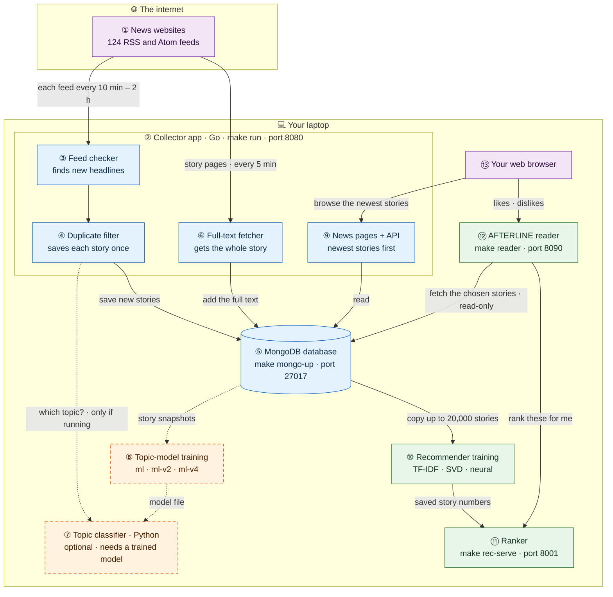
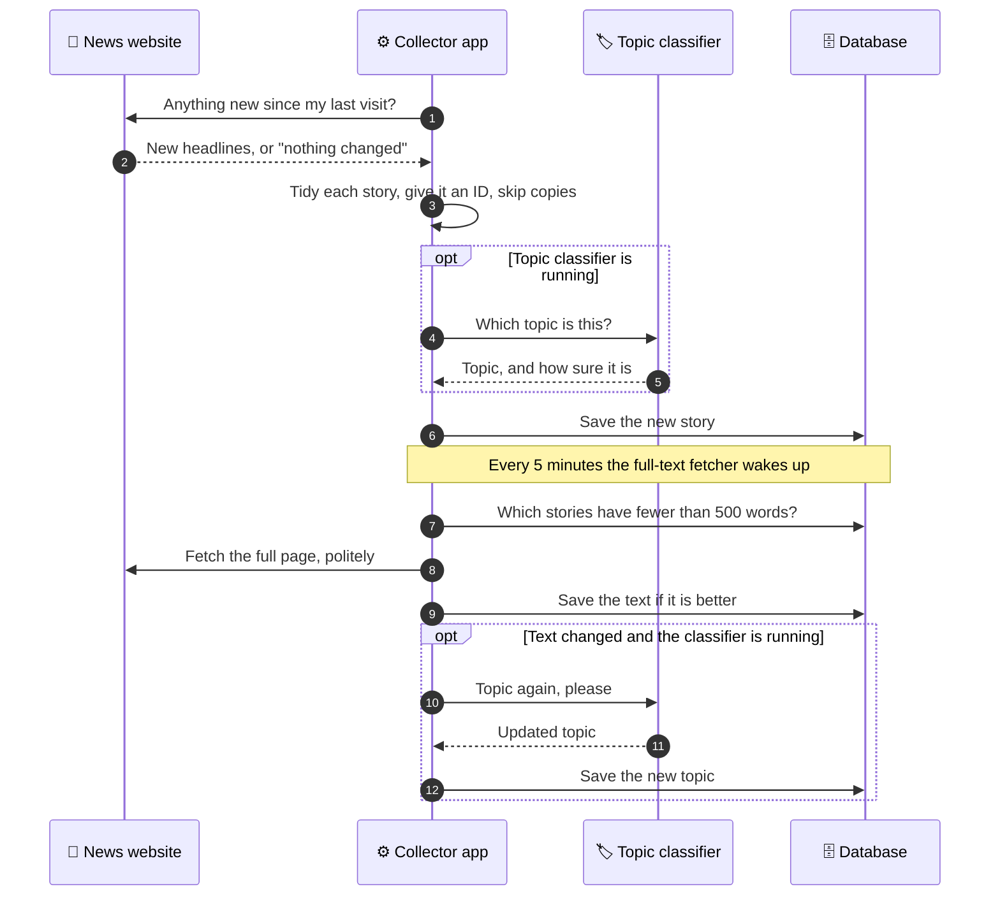
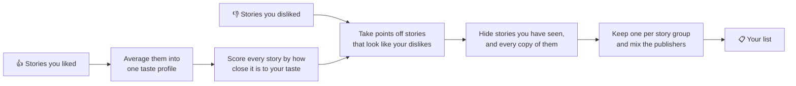
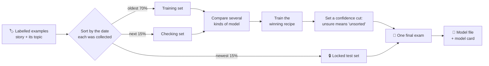

# news-bot

**Your own news robot.** news-bot reads 124 news websites around the clock, saves every new story once, can sort stories by topic, and suggests what to read next in a reader app called **AFTERLINE**. You run all of it on your own laptop.

[](LICENSE)


## Contents

1. [What is this?](#1-what-is-this)
2. [What you get](#2-what-you-get)
3. [The big picture](#3-the-big-picture)
4. [Try it on your laptop](#4-try-it-on-your-laptop)
5. [How it works](#5-how-it-works)
6. [Project map](#6-project-map)
7. [Command cheat sheet](#7-command-cheat-sheet)
8. [How to contribute](#8-how-to-contribute)
9. [Known limits](#9-known-limits)
10. [Words you'll see](#10-words-youll-see)
11. [License](#11-license)

## 1. What is this?

Keeping up with the news takes time. You visit lots of websites, see the same story again and again, and still miss things you would have enjoyed.

news-bot does the boring part for you:

- 🗞️ **It collects.** It checks 124 news feeds all day and saves each new story once.
- 🏷️ **It can sort.** A topic classifier can file each story under one of 13 topics, such as technology, health or sport.
- ✨ **It suggests.** In AFTERLINE you pick a few stories you like, and it finds more like them, including older ones you missed.

The feed list leans toward **software, data science and AI**, plus general news from India, the US, the UK and a few other countries.

It keeps a few promises:

- **English only.**
- **Free to run.** Nothing needs a paid service.
- **Private.** AFTERLINE keeps your likes in your own browser.
- **Polite to websites.** When it fetches a full article, it follows the site's robots.txt rules and waits between visits.

It's also a good way to learn how a real data project fits together: Go programs, a MongoDB database and Python machine learning.

## 2. What you get

| Part | What it does | Works today? |
|---|---|---|
| News collector | Reads 124 RSS and Atom feeds around the clock and saves each story once | ✅ Yes |
| Full-text fetcher | Fetches the whole article when a feed sends only a teaser | ✅ Yes |
| News pages and API | Shows the newest stories in your browser, and lets programs ask for feeds, stories and history | ✅ Yes |
| AFTERLINE reader | Suggests stories based on what you like, using your choice of three methods | ✅ Yes, after you build an edition ([Part B](#part-b--get-suggestions-with-afterline)) |
| Topic classifier | Files each story under 1 of 13 topics, or "unsorted" when it isn't sure | ⚠️ Needs a trained model, which isn't included yet |
| Training tools | Train and compare topic models and recommenders | ✅ Yes, for advanced users |

**Coming later** (not built yet):

- Ready-made trained models in the repo, so topics work straight away
- Sign-in for a small group of invited readers
- Saved stories and topics, with your own notes
- Adding your own RSS feeds from the reader
- Settings for professional news, local news for your city, or both
- A daily "yesterday" edition of the stories that matter to you
- Follow-up stories, and suggestions for topics you haven't picked yet
- New stories ready to suggest within an hour of being collected
- A recommender that learns from your likes and dislikes
- A read-only MCP server (MCP is a standard way for AI assistants to use tools), so an AI assistant can search the news
- Later still: a spoken briefing sized to the time you have, and an iPhone app

## 3. The big picture

Each number in the picture matches a row in the key below it.



**Colours:** purple is the outside world and you, blue is the collector, green is AFTERLINE, and dashed orange is optional. Dotted arrows lead to or from an optional part. The picture's source is [`docs/assets/system-overview.mmd`](docs/assets/system-overview.mmd).

| # | Part | What it does |
|---|---|---|
| ① | News websites | Many news sites publish a **feed**: a list of their newest stories that computers can read (RSS or Atom). The 124 feeds are listed in [`collector/configs/sources.yaml`](collector/configs/sources.yaml). |
| ② | Collector app | The main Go program. When it starts, it prepares the database and loads the feed list. Then it runs the jobs inside this box, side by side, until you stop it. |
| ③ | Feed checker | Every minute it looks for feeds that are due. Each feed has its own timer, from every 10 minutes to every 2 hours. |
| ④ | Duplicate filter | Gives each new story an ID, then checks its links, its feed ID and a "fingerprint" of its text. The same story is never saved twice. |
| ⑤ | MongoDB database | Stores the feeds, the stories and a log of every feed check. It runs inside Docker. |
| ⑥ | Full-text fetcher | Many feeds send only a teaser. Every 5 minutes it fetches the full page for stories with fewer than 500 words, slowly and politely. |
| ⑦ | Topic classifier | A small Python web service. It files a story under 1 of 13 topics, or says "unsorted" when it isn't sure. It needs a trained model file. |
| ⑧ | Topic-model training | Tools that teach the classifier from example stories that already have topics, and then pick the best model. |
| ⑨ | News pages and API | Web pages that list the newest stories, 30 per page. The API lets other programs ask for feeds, stories and the feed-check log. |
| ⑩ | Recommender training | Copies up to 20,000 English stories and turns each one into a list of numbers, in three different ways. Similar stories get similar numbers. |
| ⑪ | Ranker | A small Python service. It finds the stories whose numbers are closest to the stories you liked. |
| ⑫ | AFTERLINE reader | A Go web app that shows story cards. It asks the ranker what to show, then reads those stories from the database. It never changes the database. |
| ⑬ | Your web browser | Where you read and react to stories. Your likes are saved in your browser only. |

## 4. Try it on your laptop

Type these commands into a terminal on macOS or Linux.

### What you need

| Tool | Why | Version |
|---|---|---|
| [Git](https://git-scm.com/) | Downloads the code | any recent |
| [Go](https://go.dev/dl/) | Runs the collector and the AFTERLINE reader | 1.27 or newer |
| [Docker](https://docs.docker.com/get-started/get-docker/) | Runs the MongoDB database for you | any recent, with `docker compose` |
| `make` | Runs the short commands in this guide | usually already installed |
| [Python](https://www.python.org/downloads/) and [uv](https://docs.astral.sh/uv/) | Run AFTERLINE's tools (Part B) and the training tools | Python 3.12 |
| [Node.js](https://nodejs.org/) | Only for the browser tests, if you contribute | any recent |

### Part A — Collect the news

**1. Get the code.**

```bash
git clone https://github.com/mhd-riaz/news-bot.git
cd news-bot/collector
```

Run every other command in this guide from this `collector` folder.

**2. Start the database.**

```bash
make mongo-up
```

This starts MongoDB 7 in Docker, on port 27017.

**3. Start the collector.**

```bash
NEWS_SERVER_HOST=127.0.0.1 NEWS_AUTH_ENABLED=false make run
```

The two settings at the front are for your own laptop:

- `NEWS_SERVER_HOST=127.0.0.1` means only your own computer can reach the app.
- `NEWS_AUTH_ENABLED=false` turns the login off. The log will show a warning about this. That's expected.

> ⚠️ Never turn the login off on a computer that other people can reach.

The app prepares the database, loads the 124 feeds and starts collecting straight away. Each step prints a line in the terminal. In our test, about 3,000 stories arrived in the first minute. A few feeds may fail, for example when a site blocks robots or moves its feed. The collector tries them again later.

**4. Read the news.** Open <http://127.0.0.1:8080/> to see the newest stories.

You can also ask the API from a second terminal:

```bash
curl http://127.0.0.1:8080/health/ready                       # is everything OK?
curl 'http://127.0.0.1:8080/api/v1/articles?limit=3'          # the 3 newest stories
curl 'http://127.0.0.1:8080/api/v1/collection-runs?limit=3'   # the 3 latest feed checks
```

Leave the collector running while you try Part B.

### Part B — Get suggestions with AFTERLINE

AFTERLINE suggests stories from an **edition**: a frozen copy of the stories collected so far. An edition needs at least 100 English stories, so let the collector run for a few minutes first.

Open a second terminal in the `collector` folder:

```bash
make rec-setup     # once: installs the Python tools (a few GB)
make rec-inspect   # shows which database it will read and how many stories it holds
make rec-prepare REC_ID=my-first CUT=$(date -u +%Y-%m-%dT%H:%M:%S+00:00)
make rec-baseline REC_ID=my-first   # methods 1 and 2: TF-IDF and SVD
make rec-train REC_ID=my-first      # method 3: a small neural network
make rec-serve REC_ID=my-first      # starts the ranker; leave it running
```

- `REC_ID` names your edition. Use letters, numbers, `-` and `_`, and pick a new name for each new edition.
- `CUT` is a moment in the past. Only stories collected before it go into the edition. The `date` command above means "right now", in UTC.

In our test with about 5,000 stories, `rec-prepare`, `rec-baseline` and `rec-train` each took 11 seconds or less.

Open a third terminal in the `collector` folder:

```bash
make reader
```

Now open <http://127.0.0.1:8090/stories>:

1. Click **Choose interests** and pick up to 5 stories that catch your eye, or click **Skip for now**.
2. While you read, press **＋ More like this** or **− Not interested**. Your next suggestions change.
3. Use **Lens** to switch between the three methods (TF–IDF, Neural and SVD) and compare them.

### Stop, restart and clean up

- Press **Ctrl+C** in a terminal to stop `make run`, `make rec-serve` or `make reader`.
- To stop the database but **keep** your stories:

  ```bash
  docker compose -f deployments/docker-compose.yml stop mongo
  ```

  Run `make mongo-up` to start it again.
- ⚠️ To delete the database and **all collected stories**:

  ```bash
  make down
  ```

<details>
<summary><b>Something went wrong?</b></summary>

| You see... | What to do |
|---|---|
| `auth.enabled is true but no credentials are configured` | Put the two settings from step 3 in front of the command. |
| An error saying a port "is already allocated" or "already in use" | Another program is using that port (27017, 8080, 8001 or 8090). Stop it, or move the collector with `NEWS_SERVER_PORT=9090`. |
| `at least 100 are needed` | Let the collector run longer, then run `make rec-prepare` again. |
| `already exists; use a new snapshot id` | That edition name is taken. Pick a new `REC_ID`. |
| `cut must be a timezone-aware instant in the past` | Use a past time that ends in `+00:00`, like the `date` command in Part B. |
| The reader says "Recommendations unavailable" | Check that `make rec-serve` is still running in its own terminal. |

</details>

### Change settings or add a feed

- The collector's settings are in [`collector/configs/config.yaml`](collector/configs/config.yaml). Comments in the file explain them. The reader's settings are in [`collector/configs/reader.yaml`](collector/configs/reader.yaml).
- You can change any setting for one run with an environment variable named `NEWS_<SECTION>_<KEY>`. For example, `NEWS_SERVER_PORT=9090` changes `server.port`. That's how the two settings in step 3 work.
- To add a news feed, add an entry to [`collector/configs/sources.yaml`](collector/configs/sources.yaml), then check the file:

  ```bash
  make seed-check
  ```

  The collector loads the feed list each time it starts, so restart `make run` to pick up your change.

## 5. How it works

### 5.1 The life of a news story



1. **Ask politely.** The collector remembers what each feed said last time, so it can ask "anything new?" If nothing changed, it moves on.
2. **Tidy and check.** Each new story gets an ID that sorts by time. The collector compares the story's link, its official ("canonical") link, the feed's own ID for it, and a fingerprint of its text. If any of these match a saved story, it's a copy and gets skipped.
3. **Save.** New stories go into the database. Every feed check is written down too, so you can see what happened.
4. **Fill in the full text.** If a story has fewer than 500 words, the full-text fetcher visits its page later. It tries three different text extractors, keeps the best result, and never swaps good text for worse text.
5. **Pick a topic.** If the topic classifier is running, each new story gets a topic. When a story's text changes, it gets a fresh topic.

<details>
<summary><b>Deep dive: timers, limits and safety rules</b></summary>

| What | Default | Setting |
|---|---|---|
| Look for feeds that are due | every 60 seconds | `scheduler.interval` |
| Feeds per round, and at the same time | 50 per round, 4 at once | `scheduler.batch_size`, `scheduler.max_concurrent` |
| Each feed's own timer | 15 minutes, unless the feed list sets one (10 minutes to 2 hours) | `fetch_interval_seconds` in `sources.yaml` |
| Lock on a feed while it's read, so two collectors never read it at once | up to 5 minutes | `scheduler.lock_ttl` |
| Longest wait for a website | 20 seconds | `collector.request_timeout` |
| Biggest feed it will read | 10 MiB, and 500 stories | `collector.max_response_bytes`, `collector.max_items_per_feed` |
| Full-text fetcher | every 5 minutes, 50 stories at a time | `scraper.interval`, `scraper.batch_size` |
| Shortest text it accepts as a full story | 80 words | `scraper.min_content_words` |
| Wait between visits to the same website | 2 seconds, or longer if the site's robots.txt asks | `scraper.per_host_delay` |
| Pause a website that keeps failing | 15 minutes, after 3 failures | `scraper.circuit_failure_threshold`, `scraper.circuit_open_for` |
| Tries per article page | 3, waiting 15 minutes and then longer each time | `scraper.max_attempts`, `scraper.retry_base` |
| Skip article pages older than | 30 days | `scraper.max_article_age` |

The settings are in [`collector/configs/config.yaml`](collector/configs/config.yaml). The 500-word rule is `FullTextWords` in [`collector/internal/domain/scrape.go`](collector/internal/domain/scrape.go).

Two safety rules matter most:

- **No peeking inside your network.** The collector refuses to visit private network addresses, so a bad feed link can't make it explore your home network (`collector.allow_private_networks: false`).
- **Robots rules.** The full-text fetcher reads each site's robots.txt and obeys it.

</details>

### 5.2 How a story gets a topic

The topic classifier is a small Python web service in [`collector/ml-v2/app/`](collector/ml-v2/app). For each story it:

1. **Cleans the text.** It removes lines that a publisher repeats on every page.
2. **Detects the language**, so non-English text can be spotted.
3. **Reads the headline and the story**, and weighs its words and short letter patterns.
4. **Picks one of 13 topics** and says how sure it is. If it isn't sure enough, it answers **"unsorted"** instead of guessing.

The 13 topics are listed in [`collector/ml-v2/taxonomy.yaml`](collector/ml-v2/taxonomy.yaml): politics, crime and justice, business and economy, technology, science and space, entertainment and arts, society and lifestyle, health, education, environment and climate, disaster and accident, conflict and war, and sport.

> **Note:** the service needs a trained model file to work. Model files aren't stored in this repo yet, so a fresh copy collects news without topics. Section [5.4](#54-how-a-topic-model-learns) shows how models are trained.

### 5.3 How AFTERLINE picks stories for you

First, AFTERLINE turns every story in an edition into a list of numbers, called a **vector**. It reads the headline plus the first 250 words of the story. Stories about similar things end up with similar vectors. There are three ways to make the vectors, and you can switch between them in the reader:

| Method | The idea in plain words | Size of each vector |
|---|---|---|
| **TF-IDF** (the default) | Counts the important words and two-word phrases. Rare words count more than common ones. | up to 25,000 numbers, mostly zeros |
| **SVD** | Squeezes the TF-IDF numbers into a short summary that keeps the main themes. | up to 256 numbers |
| **Neural** | A small neural network learns to squeeze the 256 SVD numbers into 64. It practises by rebuilding them from a slightly noisy copy. | 64 numbers |

Training also sorts the edition into 8 **content groups** for browsing, and joins copies of the same story into **story groups**.

Then, every time you ask for suggestions:



<details>
<summary><b>Deep dive: the exact ranking rules</b></summary>

- **Your taste profile** is the average vector of the stories you liked. For "related stories", the story you're reading is the profile instead.
- **Closeness** is cosine similarity: a score of how much two vectors point the same way.
- **Dislikes** take away 0.2 × each story's closeness to the average of your disliked stories.
- **Before you like anything**, it shows typical stories from each content group.
- **Hidden:** stories you have viewed, liked or disliked, plus every copy of them.
- **Variety:** one story per story group. At first, no more than a third of the list (and at least 2) comes from one publisher. That limit is relaxed only when there aren't enough stories.
- Once you have likes, a story that scores zero or less is never shown.

The code is in [`collector/ml-v2/src/newsrec/index.py`](collector/ml-v2/src/newsrec/index.py).

</details>

The reader never writes to the database. Your likes and dislikes are kept in your browser's local storage, separately for each edition.

### 5.4 How a topic model learns

A topic model learns from **labelled examples**: stories that already have the right topic. The trainer in [`collector/ml-v2/src/newsmlv2/`](collector/ml-v2/src/newsmlv2) makes the kind of model the topic classifier uses. It works like this:



1. **Split by time.** The examples are sorted by the date they were collected. The oldest 70% are for training, the next 15% for checking, and the newest 15% are locked away for the final test. Copies of the same story are never split between two sets, so the model can't pass a test by memorising.
2. **Compare.** Several kinds of model learn from the training set and are scored on the checking set.
3. **Train the winner.** The current recipe weighs the words and short letter patterns in the headline and the start of the story, using a fast, simple model.
4. **Know when to say "I'm not sure".** It tunes how confident the model is, and picks one cut so the topics it files are right about 9 times out of 10 on the training data. Below the cut, it answers "unsorted".
5. **One final exam.** The locked test set is opened only once. Its scores are written into the code and the model card and never worked out again, so the test can't leak into training.

The repo has three generations of these tools:

| Folder | What's inside |
|---|---|
| [`collector/ml/`](collector/ml) | The first topic model, the example data it learned from, and a notebook that walks through it. If you want to try training, start with its own guide. |
| [`collector/ml-v2/`](collector/ml-v2) | The trainer described above. It reads the whole story, not just the headline, and the topic classifier service loads its models. |
| [`collector/ml-v4/src/newsmlv4/`](collector/ml-v4/src/newsmlv4) | Tools that choose fresh, balanced stories to label next, and check that their text hasn't changed. |

> **Honest note:** the labelled examples so far were made with AI help, not checked by people. Scores based on them show how well a model agrees with the AI's labels, not proven accuracy.

### 5.5 Where the data lives

Everything is stored in one MongoDB database called `news`. The collector creates these **collections** (think of them as drawers) when it starts. They are declared in [`collector/internal/mongodb/collections.go`](collector/internal/mongodb/collections.go).

| Collection | What it holds |
|---|---|
| `sources` | The feed list, with each feed's timer and latest status |
| `articles` | Every saved story |
| `collection_runs` | One entry for every feed check: what was found, saved or skipped |
| `feed_cache_metadata` | What each feed said last time, so the collector can ask "anything new?" |
| `application_locks` | Short-lived locks, so two workers never read the same feed at once |
| `read_events` | Views, clicks and reading time recorded by the news pages |

Only the collector writes to the database. The AFTERLINE reader and the training tools only read from it.

## 6. Project map

| Path | What's inside |
|---|---|
| [`collector/cmd/`](collector/cmd) | The programs you can run. `api` is the collector app and `reader` is AFTERLINE. `collector`, `scrape`, `seed`, `migrate` and `backfill` each do one job by hand. |
| [`collector/internal/`](collector/internal) | The Go building blocks: reading feeds, spotting copies, extracting text, the database code and the web pages. |
| [`collector/configs/`](collector/configs) | Settings and the feed list. |
| [`collector/ml/`](collector/ml) | The first-generation topic model, example data and a notebook. |
| [`collector/ml-v2/`](collector/ml-v2) | The topic classifier service (`app/`), shared text-cleaning tools (`src/newsmlv2/`) and AFTERLINE's recommender (`src/newsrec/`). |
| [`collector/ml-v4/src/newsmlv4/`](collector/ml-v4/src/newsmlv4) | Tools that choose new stories to label for the next topic model. |
| [`collector/scripts/`](collector/scripts) | JavaScript tests, run with Node. |
| [`collector/fixtures/`](collector/fixtures) | Small sample feeds used by the tests. |
| [`collector/deployments/docker-compose.yml`](collector/deployments/docker-compose.yml) | The Docker setup that `make mongo-up` uses. |
| [`docs/assets/system-overview.mmd`](docs/assets/system-overview.mmd) | The source of the big-picture diagram. |

## 7. Command cheat sheet

Run these from the `collector` folder. `make help` lists every command.

| Command | What it does |
|---|---|
| `make mongo-up` | Start the database in Docker |
| `make run` | Start the collector app: prepare the database, load the feed list, collect, and serve the pages and API on port 8080 |
| `make collect` | Check every feed that is due, once, then stop |
| `make collect-source SOURCE=<id>` | Check one feed now (get the `<id>` from `/api/v1/sources`) |
| `make scrape` | Run one round of the full-text fetcher |
| `make seed-check` | Check the feed list for mistakes without changing anything |
| `make rec-setup` | Install the Python tools for AFTERLINE (once) |
| `make rec-prepare`, `make rec-baseline`, `make rec-train` | Build an AFTERLINE edition (see [Part B](#part-b--get-suggestions-with-afterline)) |
| `make rec-serve` | Start the ranker on port 8001 |
| `make reader` | Start the AFTERLINE reader on port 8090 |
| `make ml-setup`, `make ml-test` | Install and test the first-generation topic-model tools |
| `make down` | ⚠️ Stop the Docker services and **delete their data** |

`make run`, `make collect`, `make collect-source` and `make scrape` read the collector's settings, so they need the two settings from step 3 too. Tip: run `export NEWS_SERVER_HOST=127.0.0.1 NEWS_AUTH_ENABLED=false` once in a terminal, and every command in that terminal uses them.

## 8. How to contribute

Thank you for helping! Here's the usual flow:

1. **Fork** the repo on GitHub and create a branch for your change.
2. **Set up** with [Part A](#part-a--collect-the-news). For the Python parts, run `make rec-setup` once.
3. **Make a small, focused change**, with a test that fails without it.
4. **Run the checks** for what you changed:

   | You changed... | Run |
   |---|---|
   | Go code | `make check` (format check, `go vet` and unit tests) and `make test-race` |
   | Database code | also `make test-integration`, with `make mongo-up` running |
   | Python classifier, cleaning or recommender code | `make ml2-test`, `make classifier-test` and `make rec-test` |
   | Reader web pages or browser code | `make rec-test` (it runs the Node tests too) |
   | First-generation ML tools in `collector/ml/` | `make ml-setup` once, then `make ml-test` |
   | Labelling tools in `collector/ml-v4/` | `make ml4-test` (after `make ml-setup`) |

5. **Open a pull request.** Say what you changed, why, and how you tested it. GitHub runs the main checks again on every pull request.

### House rules

These keep the project safe, honest and easy to run:

1. **No secrets in the repo.** Passwords, keys and database addresses that contain a password belong in environment variables, never in code, config files, logs or commits.
2. **Keep the original story.** Never change a story's original fields. Save anything you work out from it in new fields.
3. **Show other people's text safely.** Use Go's `html/template` on the server side and `textContent` in the browser, never `innerHTML`.
4. **Declare database changes.** Every new collection or index goes in [`collector/internal/mongodb/`](collector/internal/mongodb).
5. **Add tools only for a good reason.** Prefer Go's standard library, then a dependency the project already uses. Explain any new dependency in your pull request. The web pages have no JavaScript build step.
6. **English only, and free to run.** No feature may need a paid service.
7. **Respect publishers.** Only add English feeds whose terms allow this use, and never share the collected articles themselves. Share only numbers and charts.
8. **Back up every claim.** A number or an "it works" needs a test, a command and its output, or a measurement.
9. **Keep ML work repeatable.** Pin versions, fix random seeds, and keep notebook logic in `src/` code.
10. **Keep labels honest.** Keep human and AI-made labels apart, and never tune a model on a locked test set.

## 9. Known limits

- **No ready-made models yet.** A fresh copy has no trained topic model, so stories have no topic, and you build your own AFTERLINE edition. Bundling ready-made models is planned.
- **Editions are frozen.** New stories reach AFTERLINE only when you build a new edition.
- **No sign-in in the reader.** It's meant for your own computer only.
- **Likes stay in one browser.** They're saved per edition, so a new edition, another browser or clearing your browser data starts fresh.
- **Labels were made with AI help.** See the note in [5.4](#54-how-a-topic-model-learns).
- **English only.**

## 10. Words you'll see

| Word | What it means |
|---|---|
| Feed (RSS or Atom) | A list of a website's newest stories, written so computers can read it |
| API | A way for one program to ask another program for data |
| Database, collection | A database stores data in an organised way. MongoDB keeps similar records together in collections, like drawers in a cabinet. |
| Docker | Runs ready-made software in a sealed box called a container, so you don't have to install it yourself |
| Port | A numbered "door" on your computer that a program listens on, such as 8080 |
| Model | A file of patterns learned from examples, used to make guesses |
| Classifier | A model that sorts things into groups. Here, the groups are topics. |
| Recommender | A program that suggests things you might like |
| Vector | A list of numbers that describes something. Here, it describes a story. |
| Cosine similarity | A score of how much two vectors point the same way. 1 means the same direction; 0 means nothing in common. |
| Edition | A frozen copy of stories that AFTERLINE suggests from |

## 11. License

news-bot is open source under the [MIT License](LICENSE). You may use, copy, change and share it, including in your own projects, as long as you keep the copyright and license notice. It comes with no warranty.
