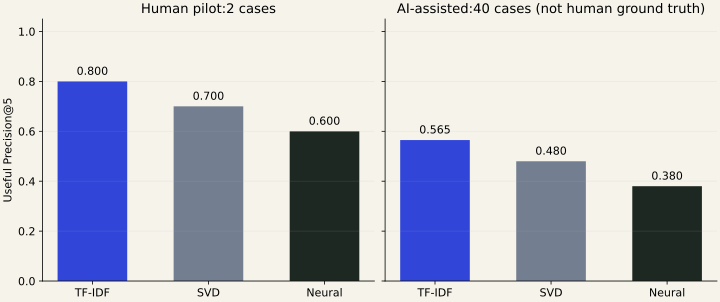

# AFTERLINE — verified delivery results

## Delivered

A working content-based news archive recommender with a read-only Go application, a private Flask vector service, a trained TensorFlow/Keras autoencoder, TF-IDF and SVD comparisons, and a responsive Stories-inspired reader.

Local reader: **http://127.0.0.1:8090/stories**

See [setup, training and evaluation](recommender.md), plus the [submission explanation and viva](recommender-submission.md).

**Reading default: TF-IDF.** It led both the small human pilot and the separate AI-assisted assessment. SVD and the trained neural model remain available for comparison; no model or frozen evaluation rankings were tuned during finalization.

### Final data and trained edition

| Measure | Verified result |
| --- | --- |
| Edition | `stories-002` |
| Database | Original `news`, through the user-configured endpoint matching the larger MCP corpus |
| Records scanned before cutoff | 165,624 |
| Collection cutoff | 2026-10-22 18:00 UTC |
| Reservoir candidates | 30,000 |
| Indexed articles | **20,000**, across **40 publishers** |
| Input coverage | 19,391 body-backed; 494 summary-backed; 115 headline-only |
| Stored images | 12,237; the remainder use the text-first design |
| Publication range | 25 October 2007–22 October 2026; clearly an archive |
| Conservative duplicate groups | 19,967 |
| Articles without usable TF-IDF features | 0 |
| Train / validation | 16,000 / 4,000; chronological group boundary |
| Network | 256 → 128 → 64 → 128 → 256, denoising input, nonlinear hidden layers |
| Network size | **82,496 parameters** |
| Training | TensorFlow 2.21.0, Keras 3.15.1, Python 3.12.15, 30 epochs |
| Recorded baseline preparation | 80.37 seconds |
| Recorded neural training/clustering stage | 7.85 seconds |
| Final validation reconstruction MSE | 0.4165 — **not a recommendation-quality score** |

All derived documents, preprocessing, models, matrices, clusters, hashes, versions and evaluation records persist under the ignored `ml-v2/artifacts/recommender/stories-002/` directory. Seeds and manifests are saved. Raw article text and secrets were not added to git.

The initial Python default pointed to a different, smaller August-only local database. That discrepancy was detected before final delivery; the user supplied the correct connection, its count was checked, and the final edition was exported/trained against the larger corpus. It is not a fixture or a claim to index the entire live database.

## Measured performance

Same frozen cases and corpus across methods. Python-only results used 140 requests/method. End-to-end results used three warm-ups plus 100 measured requests/method, including two viewed candidates per case.

| Method | Python retrieval p95 | Go + Python + Mongo p50 | End-to-end p95 | Mean publishers in top 5 |
| --- | ---: | ---: | ---: | ---: |
| TF-IDF | 6.10 ms | 12.55 ms | **15.12 ms** | 3.77 |
| SVD | 4.68 ms | 11.37 ms | **12.92 ms** | 3.62 |
| Neural | 4.34 ms | 11.13 ms | **14.07 ms** | 3.83 |

All three beat the proposed **500 ms warm local p95** target on this cohort. Exclusion checks passed on all 309 end-to-end requests: no current article, selected interest, supplied viewed item or repeated known duplicate group was returned.

These are local single-reader measurements on the inspected M1 Pro/32 GB machine and configured database connection—not load-test or full-corpus guarantees. Image downloads are outside API latency.

Idle Mongo connections produced readiness failures while fresh native database connections worked. The reader now retires idle data sockets through the driver's native **60-second maximum idle policy**, with an operator override; existing collector defaults and URI idle policies remain unchanged. No silent application retry or successful fallback was added.

The rebuilt reader passed fresh startup, a real article join, and the first read after **70 seconds idle** (51.03 ms). A deliberate clean ranking-service stop produced the expected 503; restarting the frozen service restored readiness and real article hydration. These bounded checks are recorded in `rehearsal.json`; they do not certify arbitrary long network outages or eliminate database availability risk.

## Relevance: independent user-judged pilot

The user independently rated **20 blinded candidate pairs** from **two fixed cases**:

- `article-01`: a headline-only article about state investment friendliness.
- `article-05`: an article about a new state of matter.

Each method was scored on the same pooled judgements. Grade 2 counts as useful for Precision@5; grades 0/1/2 contribute to graded pooled nDCG.

| Method | Useful Precision@5 | Pooled nDCG@5 | Cases judged |
| --- | ---: | ---: | ---: |
| **TF-IDF** | **0.80** | **0.9349** | 2 of 40 |
| SVD | 0.70 | 0.6596 | 2 of 40 |
| Neural | 0.60 | 0.5755 | 2 of 40 |

**The neural model did not outperform the baseline on this pilot.** Two cases are too few for a broad quality claim, a statistical superiority claim, or certification of the full relevance target. The remaining **38 cases / 417 pairs have not been human-judged**. The original user sheet remains unchanged; AI ratings are stored separately.

## Separate, user-approved AI-assisted assessment

A single blinded AI pass rated **all 437 candidate pairs across the 40 frozen cases**, including the two pilot cases independently. The evaluator saw query context and shuffled candidate titles/excerpts, but no method names, ranks, similarity scores or previous human grades.

| Method | Useful Precision@5 | Pooled nDCG@5 | AI-assessed cases |
| --- | ---: | ---: | ---: |
| **TF-IDF** | **0.565** | **0.8526** | 40 |
| SVD | 0.480 | 0.7375 | 40 |
| Neural | 0.380 | 0.6435 | 40 |



| AI-assessed slice | Cases | TF-IDF P@5 | SVD P@5 | Neural P@5 |
| --- | ---: | ---: | ---: | ---: |
| Related-article queries | 30 | 0.4667 | 0.4400 | 0.3867 |
| Multi-interest profiles | 10 | 0.8600 | 0.6000 | 0.3600 |
| Headline-only subset of related queries | 5 | 0.3200 | 0.3600 | 0.2800 |

These are **AI-assisted proxy results, not human ground truth**. The AI pass exactly agreed with only **8 of the 20** overlapping user grades, so it cannot be treated as a validated replacement for the user. Judgements are based on visible text, not factual verification or actual reader behavior. Rationales, label provenance and per-case metrics persist alongside the frozen edition.

TF-IDF is the conservative reading default because it is simpler and led both available aggregate comparisons. This is a practical choice, not a statistically established population winner. The neural method remains trained and integrated as the honestly evaluated coursework experiment.

**The original full human-relevance acceptance target remains unverified.** Even the AI-assisted TF-IDF P@5 is below 0.60. We did not tune on these fixed cases or relabel them to manufacture a passing result; any future quality improvements need a separate development set and fresh held-out assessment.

The separate 100-query old-training-label proxy, over a common restricted pool of 692 labelled articles, measured same-category top-five agreement of TF-IDF 0.580, SVD 0.656 and neural 0.624. That measures coarse category agreement, not reading preference or human relevance; it does not replace the manual benchmark.

The benchmark is an in-catalog related-reading experiment. It does not establish prediction of unseen users' clicks, long-term satisfaction or recommendation quality for future unindexed articles.

### Reproduce the limited manual pilot

From `collector/ml-v2/`:

```bash
uv run --no-sync newsrec score --id stories-002 \
  --judgements artifacts/recommender/stories-002/judgements.jsonl \
  --case article-01 --case article-05
```

The original user ratings also persist in `manual-pilot-grades.json`. The selected-case result is `relevance-selected.json`; it does not overwrite a full evaluation. Complete the other cases with independent human judgements before claiming a full human result.

The separate AI-assisted result can be reproduced without altering the user sheet:

```bash
uv run --no-sync newsrec score --id stories-002 \
  --judgements artifacts/recommender/stories-002/ai-judgements.jsonl \
  --label-source ai-assisted
```

It writes `relevance-ai-assisted.json`. The scorer rejects mixed or mismatched label sources. All 120 explicit method/case rankings and the original model/retrieval hashes were rechecked unchanged.

## Verification

| Suite / package | Passed | Failed | Skipped | Coverage |
| --- | ---: | ---: | ---: | --- |
| Full Python suite | **199** | 0 | 0 | Recommender 94%; ranking 99%, Flask API/CLI 100% |
| JavaScript state checks | **18** | 0 | 0 | 58.19% lines / 90.23% branches |
| Go recommendation service | 7 | 0 | 0 | 96.5% |
| Go HTTP handlers | 66 | 0 | 0 | 95.9% |
| Go web package | 23 | 0 | 0 | 90.1% |
| Go configuration | 33 | 0 | 0 | 92.4% |
| Go Mongo wrapper | 11 | 0 | 0 | 16.9% |
| Go reader command | 2 | 0 | 0 | 33.8% |

Go counts above are top-level tests in the changed surfaces; subtests are not counted again. Focused race tests and `go vet` passed. Low driver/startup unit coverage is supplemented by actual read-only startup, batch hydration and idle/restart checks; it is not claimed as instrumented coverage. JavaScript line coverage remains below the proposed 80% target despite the functional browser checks.

**Full-repository Go caveat:** the final whole-repo run exposed the pre-existing `TestConcurrentAcquireReservesDistinctSlots` failure in `internal/ratelimit` (six recorded waits versus seven expected). It also reproduced during 30 focused iterations. That package is unchanged from the existing commit; the concurrent test's fake sleep advances a shared clock, making the number of waits scheduling-dependent. It was not silently changed or excluded to manufacture an all-green repository claim. The isolated `make rec-test` delivery target passes.

The original saved classifier still loads and predicts; its closed test split was not reopened. The reader exposes no mutation routes, and `read_events` remained zero during the integration checks.

Browser verification covered:

- Real Mongo data and trained representations through the running API and reader.
- Desktop presentation, onboarding with three real selected articles, stored interests, related mode, model lenses and the legacy archive.
- Interest updates followed by new recommendations; previous/next and native keyboard navigation.
- A 390-pixel viewport with no page-level horizontal overflow and a synthetic touch-pointer swipe.
- Actual missing-image text-first rendering with real articles.
- Headline-only, empty/end-of-feed and 503/retry states using **explicit temporary browser-response fixtures**, then recovery to real data. These fixtures were not stored, trained on or left in the running integration.

A shared related-mode bug was caught with a failing regression test: unrelated saved interests could dilute the opened article. It was fixed in the common retrieval function. All 120 pre-existing method/case rankings were rechecked unchanged before the user's blinded judging; the judgement pool itself was preserved.

A browser reload also caught an initial-loading regression introduced by server-selected defaults. A failing runnable test reproduced the missing-lens lookup; the shared loading renderer was fixed. The final browser check verified TF-IDF on first load, explicit Neural selection, return to TF-IDF, no page errors and no page-level overflow at 390 pixels.

Keras/joblib emit upstream NumPy deprecation warnings during some tests; checks pass. No library source or unrelated tests were rewritten to hide them.

## Boundaries

- Original Mongo articles were not modified. The reader starts no collector, scraper, migration, classifier scheduler or telemetry writer.
- New articles need a new explicit edition/index build. This delivery indexes 20,000, not every live Mongo record.
- Language checks and conservative duplicate detection are imperfect. Near-duplicate grouping remains quadratic offline work on the bounded subset; scale it only after adding candidate blocking.
- Preferences are browser-local: 50 positive, 50 negative and the last 2,000 viewed IDs. There are no accounts or cross-device profiles.
- Publication timestamps are stored collector values; some fall back to collection time. Publisher images, original links, rights, paywalls and hotlink policies are not guaranteed.
- TF-IDF is the reading default; the trained Neural lens remains available for the academic comparison.
- AI assessment is complete but is not a replacement for the remaining human judgements. Do not present the full relevance target as passed.
- The local submission archive preserves source, models and evaluation records without credentials; keep it private and copy it off this laptop for disk-loss protection.
