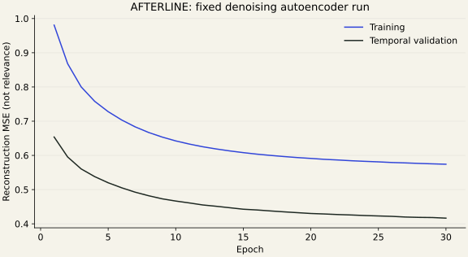

# AFTERLINE: unsupervised neural news recommendation

## Abstract

AFTERLINE is a content-based recommendation system built on an existing MongoDB news corpus. It compares sparse TF-IDF cosine retrieval, a latent semantic SVD control, and a TensorFlow/Keras denoising autoencoder trained on article content. The encoder maps standardized 256-dimensional inputs into 64-dimensional representations. Unsupervised clustering supports cold-start exploration, while explicit article selections form a browser-local interest profile. A read-only Go application joins ranked IDs back to original articles and presents a responsive, accessible story reader. Evaluation distinguishes reconstruction error, coarse category agreement, human relevance judgements and an explicitly separate AI-assisted assessment.

## Problem and scope

The original project classified news into predefined topics. Recommendation asks a different question: **which archived article is useful next, given an opened article or selected interests?**

No usable historical user-item interaction data was available. The existing `read_events` collection was empty, and its schema had no user identifier. Collaborative filtering and claims such as “readers like you” would therefore be unsupported.

The delivered system:

- Recommends related articles and articles matching explicit interests.
- Supports cold start through representative real articles and content groups.
- Excludes the current article, selected interests, known duplicate groups and supplied viewed history.
- Adapts subsequent retrieval to interested/not-interested choices.
- Preserves the original database and distinguishes archived publication dates from current news.

Accounts, social features, continuously retrained feeds and full-corpus scaling are outside the MVP.

## Data preparation

The final `stories-002` edition scans **165,624** records collected before **22 October 2026, 18:00 UTC**. A seeded reservoir selects **30,000** candidates; **20,000** cleaned articles from **40 publishers** form the frozen index.

| Input | Articles |
| --- | ---: |
| Headline plus body opening | 19,391 |
| Headline plus stored summary | 494 |
| Headline only | 115 |
| Stored image available | 12,237 |

The source's language field is not trusted: earlier profiling found Hindi content marked English. Existing cleaning and boilerplate logic is reused alongside script and seeded language checks. Original facts, people, places and numbers are not deliberately removed from recommendation features.

Each model receives the headline plus up to **250 cleaned supporting words**, preferring body, then summary. A repeated leading headline is not added twice. Displayed text is labelled stored summary, excerpt or headline only; no facts or summaries are generated.

Conservative duplicate grouping combines URL/content hashes and high-cosine candidate matches, with the existing time guard for recurring features. There are **19,967** groups. Near-duplicate comparisons use 64-row batches, not a retained full similarity matrix; their offline work is still quadratic on this bounded cohort.

The group-aware temporal boundary yields **16,000 training** and **4,000 validation** articles. TF-IDF, SVD and scaling fit on training data only. Groups crossing the boundary remain in validation. Category labels and the old classifier's closed test set do not train the representation model.

## Architecture

```text
Original MongoDB articles
          |
   read-only bounded export
          |
 clean, language checks, duplicate grouping
          |
     frozen edition + hashes
          |
     TF-IDF vocabulary
          |
      SVD, 256 dimensions
          |
   standardization on train
          |
 TensorFlow denoising autoencoder
          |
    centered 64D representations
          |
   cosine retrieval + exclusions
          |
 Go API: one Mongo metadata batch
          |
      AFTERLINE story reader
```

The trained representations are precomputed. Serving uses NumPy/scikit-learn artifacts and does not need to import TensorFlow. New articles enter only after a new explicit edition build.

## Models and learning objective

### TF-IDF baseline

TF-IDF weights terms that are frequent in an article but less common across the training corpus. Word unigrams/bigrams, a bounded vocabulary of 25,000 terms, and normalized cosine similarity give a transparent non-neural baseline.

### SVD control

Truncated SVD reduces sparse word features to 256 dense dimensions. Comparing SVD-only retrieval with neural retrieval separates the effect of dimensionality reduction from any benefit of the network.

### Neural model

```text
256 inputs
 -> Gaussian noise (0.05)
 -> Dense 128, GELU
 -> Dense 64, bottleneck
 -> Dense 128, GELU
 -> Dense 256, linear reconstruction
```

The network has **82,496 parameters**. Adam minimizes mean squared reconstruction error between the clean standardized input and decoder output. Validation-based early stopping can restore the best weights; the delivered run used 30 epochs with fixed seeds on CPU.

For input `x`, encoder `f`, decoder `g`, the objective is:

```text
minimize mean(||x - g(f(noisy(x)))||^2)
```

No category targets, user ratings or recommendation judgements enter that loss. The identifiable unsupervised components are representation learning, SVD and content clustering. Eight MiniBatchKMeans groups provide keyword-labelled circles and representative articles, not verified editorial categories.

The final validation reconstruction MSE is **0.4165**. This is a training diagnostic, **not evidence that readers like the recommendations**.



## Recommendation behavior

In related mode, the opened article anchors the query; unrelated saved interests cannot dilute the meaning of “related.” In personalized mode, selected positive article vectors are averaged and normalized. Explicit negative choices penalize similar content; merely turning a page is not a dislike.

Cosine similarity is:

```text
similarity(a, b) = dot(a, b) / (norm(a) * norm(b))
```

Known duplicate groups, the current article, selected interests and viewed IDs are excluded before results are returned. A simple publisher-diversity cap is relaxed only when necessary; duplicate/history exclusions are not relaxed.

Profiles are stored in the browser per edition, with explicit limits of 50 positive choices, 50 negative choices and the last 2,000 viewed IDs. This is content-based adaptation, **not historical preference-model training**.

## Interface and reliability

The reader uses the existing Go templates, native CSS and plain JavaScript, without a new frontend framework or runtime dependency chain. Topic circles lead to a focused story card with next/previous, touch-pointer and keyboard navigation. There is no autoplay or countdown.

The design includes real-image and text-first modes, absolute archive dates, original-source links, loading/error/retry states, empty/exhausted feeds, explicit feedback and profile reset. Third-party article content is escaped or assigned as text, not inserted as HTML.

The separate read-only entry point starts no migrations, collection workers, scrapers, classifier scheduler or telemetry writer. Native idle-pool retirement addresses the observed stale data-connection problem without disguising dependency failures as successful feeds.

## Evaluation and conclusions

The [verified results](recommender-results.md) are the authoritative measured tables, including final method selection and separate evaluation provenance.

Evaluation uses the same frozen 40 cases and corpus for each method: 30 related-article queries and 10 explicit multi-interest profiles. Top-five results are pooled and shuffled for judging. Precision@5 counts useful next reading; graded pooled nDCG measures ranking quality.

Keep these evidence sources separate:

1. **Human pilot:** 20 user ratings from two cases; too small for broad claims.
2. **AI-assisted assessment:** explicitly machine-judged, method-blinded labels; not a replacement for human validation.
3. **Category proxy:** old-training-label agreement, not reading relevance.
4. **Engineering checks:** latency, exclusions, artifact integrity and browser journeys, not user satisfaction.

Models and ranked evaluation cases remain fixed during assessment. Faster retrieval or lower reconstruction loss does not establish superior relevance. A simpler baseline beating the neural model is a valid academic result, not a reason to conceal the comparison.

In the delivered edition, TF-IDF led the two-case human pilot (P@5 0.80) and the separate 40-case AI-assisted assessment (P@5 0.565, compared with 0.480 for SVD and 0.380 for Neural). It is therefore the reading default. The full human-relevance target is not certified, and the AI-assisted number itself is below 0.60. These limitations are part of the conclusion, not omitted from it.

## Five-minute demonstration

1. Start the private representation service and the read-only reader using the [run instructions](recommender.md).
2. Show the named edition, its 20,000-article coverage and honest archive dates.
3. Browse a content circle, then select a few actual articles as interests.
4. Open a story, request related reading, and demonstrate interest/negative feedback.
5. Switch TF-IDF, SVD and Neural lenses; distinguish similarity scores from liking probabilities.
6. Show a text-first card, keyboard navigation, and a reset of local preferences.
7. Explain the frozen pipeline, trained network and separate evaluation tables.

## Preserving the demonstrated edition

The local submission archive contains the recommender source, run configuration, documentation and frozen trained edition. It deliberately excludes `.env`, credentials, virtual environments and generated executables. The archived file manifest and archive SHA-256 allow integrity checks without retraining.

Restore only into a **new, empty directory**. Configure the database connection again, run `make rec-setup` from the restored `collector/`, then use the two-terminal run instructions. The article-ID join still requires the original Mongo database; the archived prepared text is not silently substituted as a fake working integration.

The archive includes collected article text and user/AI evaluation records for local reproducibility. Keep it private unless dataset redistribution rights and any submission requirements have been checked. Copy it to a separate device or private storage for protection against disk loss; a second file on this laptop is not an off-device backup.

## Viva questions

**Why content-based instead of collaborative filtering?**  
There is article content but no usable user-item history. Explicit selections form a content profile; collaborative preference claims would be unsupported.

**Where is unsupervised learning?**  
SVD, autoencoder reconstruction and k-means grouping learn structure without category targets.

**Where is TensorFlow used meaningfully?**  
It trains the nonlinear 82,496-parameter encoder/decoder on 16,000 real articles; the saved bottleneck vectors drive an integrated retrieval method.

**Why use SVD before the network?**  
It avoids densifying 25,000-dimensional sparse features and keeps local CPU training manageable. SVD-only retrieval is retained as a control.

**Why a denoising objective?**  
The encoder reconstructs clean features from mildly perturbed inputs. That encourages robustness, but its benefit must be judged through retrieval quality.

**Why not use all articles immediately?**  
A frozen 20,000-article cohort makes preparation, comparison and deadline delivery tractable. Full-corpus preparation needs more efficient duplicate candidate blocking.

**How do headline-only articles work?**  
They use the same preprocessing with no invented supporting text. Their quality should be inspected as a separate slice.

**How do you avoid leakage?**  
Story grouping and chronological splits separate representation fitting/validation; category and relevance labels never train the unsupervised model. The old classifier test set stays closed.

**How is recommendation quality measured?**  
Same-case Precision@5 and pooled nDCG, with human and AI label sources reported separately, plus latency/diversity and functional checks.

**Does lower loss mean better recommendations?**  
No. Reconstruction optimizes an input-copying objective, not reader utility.

**What if TF-IDF wins?**  
Use the simpler method for reading and retain the trained neural method as an honestly evaluated experiment.

**What are the main limitations?**  
Small human judgement coverage, AI-assessment bias, English-language and publisher imbalance, imperfect duplicates/dates, browser-local history, archived-only indexing and dependency availability.
