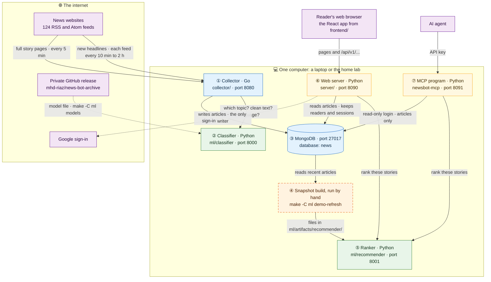

# How news-bot fits together

news-bot is made of a few small programs. Each one does one job. They share one
database. This page shows the parts, the path a story takes, the database, and how
people and AI agents get in.

Hard words are explained in the [glossary](../glossary.md).

## The parts

| Part | Folder | Language | Port | Its job |
| --- | --- | --- | --- | --- |
| Collector | [`collector/`](../../collector/README.md) | Go | 8080 | Reads 124 news **feeds**, saves new stories, fetches the full text, and asks the classifier for a topic. It is the only program that writes stories into the database. |
| Classifier | [`ml/classifier`](../services/classifier.md) | Python | 8000 | Reads a story and says which of 13 topics it is about. It also returns cleaned text and the language it detected. |
| MongoDB | — | — | 27017 | The **database**. It keeps the stories, the news sources and the readers. |
| Snapshot build | [`ml/src/newsrec`](../services/recommender.md) | Python | — | A step you start by hand (`./run.sh refresh`, or `make -C ml demo-refresh`). It copies recent stories out of the database into a **snapshot** and trains the ranking methods on it. |
| Ranker | [`ml/recommender`](../services/recommender.md) | Python | 8001 | Loads one snapshot and picks stories a reader may like. It never opens the database. |
| Web server | [`server/`](../services/server.md) | Python | 8090 | Serves the reader's pages and API, and handles Google sign-in. |
| Reader app | [`frontend/`](../services/frontend.md) | TypeScript (React) | — | The pages people read in their browser. The web server sends them. |
| MCP program | [`server/`](../services/server.md#the-mcp-program-for-ai-agents) | Python | 8091 | Lets AI agents search and read stories. It can only read. |

Each port above is the default. On a laptop, `run.sh` opens these ports on
`127.0.0.1` (this computer only), so other computers cannot reach them.

## The picture

The source of this picture is [`../assets/system-overview.mmd`](../assets/system-overview.mmd).

Colours: purple is outside the computer. Blue is collection, green is machine
learning, and yellow is what readers and agents talk to. The dashed orange box is a
step you run by hand.

## What runs where today

- **On a laptop**, `run.sh` starts the parts for you. See
  [Getting started](../getting-started/README.md).
- **In production**, the stack that Coolify runs on the home-lab laptop has only
  three parts: MongoDB, the classifier and the collector. The file is
  [`deployment/compose/coolify.compose.yml`](../../deployment/compose/coolify.compose.yml).
  The ranker, the web server and the MCP program are not deployed yet. See
  [Operations](../operations/README.md).

## The path of a story, from feed to reader

1. **Find new headlines.** Inside the collector, a **scheduler** wakes every 60
   seconds. It picks the sources whose turn has come. Each source has its own wait
   time. In `collector/configs/sources.yaml` it is between 10 minutes and 2 hours.
2. **Read the feed.** The collector downloads the feed and reads each item. It turns
   HTML into plain text and tidies the link.
3. **Ask the classifier.** The collector sends the new items to the classifier in
   batches. The classifier answers with a topic, a confidence score, cleaned text
   and the detected language. If the classifier is down, the stories are still
   saved, and the collector asks again later.
4. **Skip copies, save the rest.** The collector checks four keys in order: the
   tidied link, the publisher's own link, the feed's ID for the item, and a **hash**
   of the text. A story it already has is skipped. A new one is written into the
   `articles` collection. The original text is kept, and the cleaned text goes
   into new fields.
5. **Get the full text.** Many feeds carry only a short summary. Every 5 minutes, the
   collector fetches the web page of stories with fewer than 500 words. It obeys
   each site's `robots.txt` rules and waits between requests to the same site. If it
   finds a longer text, a page date or a missing picture link, it saves it and sends
   the story to the classifier again.
6. **Make a snapshot.** This step is started **by hand** today, with
   `./run.sh refresh` or `make -C ml demo-refresh`. It copies recent stories into a
   snapshot folder under `ml/artifacts/recommender/`. Then it builds three ranking
   methods: TF-IDF, SVD and a small neural network.
7. **Rank.** The ranker loads the snapshot. When asked, it returns a list of story
   IDs in order. It only knows the stories in its snapshot.
8. **Fill in the details.** The web server takes those IDs and reads the stories
   from MongoDB in one query. It keeps the ranker's order.
9. **Show.** The React app in the reader's browser shows the stories.

So a new story reaches readers only after the next hand-made snapshot and a ranker
restart. The planned automatic pipeline would make a new story recommendable within
1 hour. It is not built yet (roadmap milestone M2).

## The database

The database is MongoDB, and it is called `news`. A **collection** is one group of
records, like one sheet in a spreadsheet.

Only the collector may create collections and **indexes** (sorted lists that make
searching fast). Every collection and index is declared first in
[`collector/internal/mongodb`](../../collector/internal/mongodb/collections.go). The
collector creates them when it starts.

### Who may read and write

Each program logs in with its own database user. The script
[`deployment/mongo/mongo-users.js`](../../deployment/mongo/mongo-users.js) creates six
users: `collector`, `batch`, `ranker`, `reader`, `owner` and `mcp`. MongoDB itself
then refuses anything a user is not allowed to do. The `reader` user is the web
server, and `mcp` is the MCP program. `batch` and `ranker` are for the planned
automatic pipeline.

The full rules are table C14 in the [roadmap](../project/roadmap.md#c14-database-permissions).
In the table below, R = read, W = add or change, D = delete, and — = no access.

**Collections that exist today:**

| Collection | What it holds | collector | reader (web server) | mcp | owner |
| --- | --- | --- | --- | --- | --- |
| `articles` | One record per story | R W D | R | R | R |
| `sources` | The news feeds and their health | R W D | R W | — | R W D |
| `collection_runs` | One record per attempt to read a feed | R W | — | — | R |
| `feed_cache_metadata` | Data that lets a feed answer "nothing new" | R W | — | — | R |
| `application_locks` | Short **leases**, so two collectors never read the same feed at once | R W D | — | — | R W D |
| `read_events` | Old reading reports. Nothing writes them now, but the data is kept | R W | — | — | R D |
| `readers` | Invited readers | — | R W | — | R W D |
| `reader_sessions` | Signed-in sessions | — | R W D | — | R D |

`batch` may also read `articles` and use `application_locks`. `ranker` has no access
to these collections.

**Collections that are planned but not created yet:** `index_generations`,
`pipeline_runs`, `association_rules`, `story_links`, `topic_labels`,
`reader_events`, `reader_settings`, `saved_items` and `editions`. Their rules are
already in C14 and in `mongo-users.js`.

MongoDB checks rules for a whole collection, not for each record. So the rule "a
reader may change only the feeds they added" must be checked by the web server's
own code.

## How sign-in works

Sign-in is for people who read. It uses Google. Only invited readers can get in.

1. The owner invites an email address with `newsbot-server readers invite`.
2. The reader clicks "Sign in with Google". The server sends them to Google with
   **PKCE** (a one-time secret that proves the same browser finishes the sign-in).
3. Google sends the reader back to `/auth/callback`.
4. The server checks that Google says the email is verified, and that it is on the
   invite list. The first sign-in links that Google account to the invite.
5. The server sets a session **cookie** called `__Host-newsbot_session`. The
   database keeps only a SHA-256 hash of it, never the cookie itself.
6. A session ends after 7 days without use, or 30 days in total. Signing out, or
   the owner revoking the reader, ends it at once.

Every request that changes something must come from the app's own pages. The server
checks the browser's `Sec-Fetch-Site` header, and then the `Origin` header. This
stops other websites from acting with a reader's cookie.

**Status:** sign-in is built, and it is tested with a fake Google. It has not been
tried with a real Google OAuth client yet, because the owner has not created one
(roadmap D10). Details: [server guide](../services/server.md#sign-in).

## How AI agents get in (MCP)

**MCP** (Model Context Protocol) is a standard way for AI agents to use tools. The
MCP program `newsbot-mcp` offers five read-only tools: `search_articles`,
`get_article`, `get_related`, `get_recommendations` and `list_topics`.

- **Over the network** (HTTP, port 8091), each agent sends its own key. The program
  keeps only a SHA-256 hash of each key, in `NEWS_MCP_API_KEYS`. To take a key away,
  remove its entry and restart the program.
- **On the same computer**, an agent can start the program itself and talk to it
  over **stdio** (its standard input and output). No key is needed then. The shared
  editor settings in [`/.mcp.json`](../../.mcp.json) do this.
- The program logs in to MongoDB as `mcp`. That user may only read `articles`. The
  program checks this when it starts, and refuses to run if the login could write.
- Each key may make 60 requests a minute by default.
- `get_story_group` and `get_rules` are not offered yet. They need story links and
  association rules (roadmap M5).

The MCP program is not deployed in production yet. Details:
[server guide](../services/server.md#the-mcp-program-for-ai-agents).

## Not built yet

These parts of the plan do not exist in code yet. The full list is on the
[status page](../project/status.md).

- The automatic pipeline that keeps the ranker up to date (roadmap M2).
- Server-side likes, settings, saved items and reader-added feeds (M3).
- Stored daily editions for each reader (M4).
- Topic suggestions and follow-up stories from association rules (M5).
- The planned two-tower recommendation model (M6).
