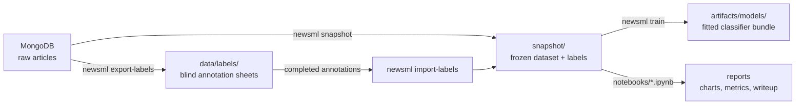

# `ml/` — legacy classifier study and shared offline tooling

**Status, 25 Nov 2026:** this is the closed v1 classifier study, not the current
product plan or production classifier. Its offline commands read MongoDB and
write local artifacts; cleaning, annotation and near-duplicate utilities are
also reused by newer tooling. The Go collector now supports enrichment and a
body-aware classifier sidecar. The local AFTERLINE reader is a separate process.

**Label provenance correction (roadmap D16, 22 Nov): all old and new classifier
label datasets are AI-generated**, including labels previously described as
human gold. Historical `gold.jsonl` filenames, `human` metadata, notebook prose,
reports and model-card wording do not establish human authorship. Those artifacts
and measurements are preserved, but their human-origin claims are superseded:
classifier scores and calibration describe agreement with AI labels, not
human-validated accuracy. Human validation and 200 human labels per class are
**not met**. This correction does not change the separate recommender human pilot.

For current work, use the [roadmap](../../../project/roadmap.md). The body-aware serving
implementation is in [`ml-v2`](../../../../ml/src/newsmlv2/serve.py), the pooled AI-label
V4 model (approved for production on 27 Nov, D19) is documented in [`ml-v4`](../../../services/classifier.md), and
reader/demo commands are in the [recommender guide](../../../services/recommender.md).

## 1. The five-minute mental model



- **MongoDB** holds every collected article. `ml/` only ever reads it.
- A **snapshot** is a frozen, reproducible copy of "the corpus + the labels
  that exist as of this moment", written to `data/snapshots/<id>/`. Every
  number in the notebook is computed from one snapshot, not the live,
  growing database — re-run the notebook next month and the numbers don't move.
- **Imported labels are AI-generated (D16).** The legacy workflow distinguishes
  imported annotations from weak guesses derived from feed sections, publisher
  hints and category tags. That distinction is not human-versus-AI provenance.
  The export/import commands validate sheets and agreement, not who authored them.
- **Training** fits a model against a snapshot and writes a "bundle" (the
  fitted model + per-class confidence thresholds + a model card) to
  `artifacts/models/`.
- **The notebook** is where you *read* the results — it calls the library in
  `src/newsml/`, it never contains modelling logic itself.

## 2. Directory map

```
ml/
├── src/newsml/       the actual logic — everything else only calls this
├── notebooks/        one notebook that reads a snapshot and reports on it
├── tests/            pytest suite for src/newsml/
├── data/             labels, near-dup pairs, and frozen snapshots (mostly gitignored)
├── artifacts/        boilerplate.yaml + trained model bundles (mostly gitignored)
├── reports/          corpus profile report + figures
├── taxonomy.yaml     the fixed list of 13 topic classes
├── pyproject.toml    dependencies (managed with uv)
└── requirements.txt  same deps, plain pip format
```

### `src/newsml/` — what each module is for

Think of this as a pipeline, roughly top to bottom:

| Module | Purpose | You touch this when... |
|---|---|---|
| `load.py` | Read-only access to MongoDB (the raw "bronze" articles). | never directly — everything else calls it |
| `clean.py` | Normalise text: unicode, quotes/dashes, strip datelines/wire credits/share prompts. | you see junk text getting through to the model |
| `admit.py` | Decide what even counts as an article — drops horoscopes, listicles, weather bulletins, stubs under 12 words, each with a reason code. | a non-article is leaking into training data |
| `boilerplate.py` | Learn each source's boilerplate lines automatically instead of hand-listing them. | onboarding a new, noisy source |
| `neardup.py` | Find near-duplicate articles (same wire story, reworded) via MinHash/LSH, so they can't land on both sides of a split. | tuning how aggressively duplicates are grouped |
| `pairs.py` | Build/calibrate the labelled pair sheet used to tune the near-dup threshold. | recalibrating near-dup detection |
| `labels.py` | The taxonomy and "weak" labels guessed from feed section / publisher / category tags. | changing what a feed section maps to |
| `annotate.py` | Build blind labelling sheets and validate completed annotations (agreement checks, adjudication, targeted sampling for thin classes). | studying the legacy workflow; future genuine human review needs explicit provenance |
| `splits.py` | The legacy **grouped, temporal** train/validation/test split. V4 instead uses a stratified holdout and repeated stratified folds. | changing the legacy split logic |
| `dataset.py` | Glues it all together: clean → admit → dedupe → label → split → the `Dataset` the models train on. | the main "build me a dataset" entry point |
| `models.py` | The model ladder (majority baseline → Naive Bayes → linear SVM → SGD) and how each is scored. | adding/removing a model to compare |
| `thresholds.py` | Per-class confidence cuts so the model can say "unsorted" instead of guessing wrong; some classes are forced to always abstain. | tuning precision vs. coverage |
| `snapshot.py` | Freeze a dataset + labels to disk as a reproducible, hashable snapshot. | you want a number that doesn't change tomorrow |
| `train.py` | Fit the legacy classifier from a snapshot, choose thresholds and write its model card + bundle. | reproducing the v1 study, not promoting V4 |
| `profile.py` | Corpus-wide stats report (counts, field coverage, sources) — no modelling. | just want to know what's in the DB right now |
| `config.py` | Constants and the Mongo URI resolution (env var → `.env` fallback). | pointing at a different database |
| `cli.py` | Wires all of the above into the `newsml` command (see below). | adding a new CLI command |

Every module has a docstring at the top explaining the "why" in more detail —
worth reading before changing one.

### `data/` and `artifacts/`

- `data/labels/` — the labelling sheets and the resulting `gold.jsonl` files
  (one folder per round: `pilot`, `v1`, `v2`, `v3`). Mostly gitignored raw
  sheets; these imported label files carry AI annotations despite their legacy names.
- `data/pairs/` — the near-duplicate calibration sheet and its answer key.
- `data/snapshots/<id>/` — frozen datasets. `<id>` is a date-based tag; a
  snapshot directory has a manifest, digests, and joined labels.
- `artifacts/boilerplate.yaml` — per-source template lines discovered by
  `newsml boilerplate`, reviewed by hand, then used by `clean.py`.
- `artifacts/models/<name>-<snapshot-id>/` — a fitted model bundle: the
  `.joblib` file (gitignored, ~11 MB), `manifest.json`, and `model-card.md`
  (both committed — provenance without the binary).

## 3. Setup

```bash
cd ml
uv sync --group dev        # or: make ml-setup, from collector/
```

Uses **uv** with `.python-version` pinned to 3.12 and
`requires-python = ">=3.12"` in `pyproject.toml`. The version constraint alone
is not certification of every newer interpreter.

Reading the live database needs a Mongo URI. `config.mongo_uri()` falls back to
reading `NEWS_MONGO_URI`/`NEWS_MONGO_DATABASE` out of `../.env` automatically —
you don't normally need to export anything by hand.

## 4. How to run things

Everything is a subcommand of `newsml`, run from inside `ml/` (`uv run newsml
<command>`), or via a `make ml-*` target from `collector/`. Prefer the
`make` targets — they fill in the fiddlier flags for you.

| I want to... | Command | What it does |
|---|---|---|
| See what's actually in the database | `make ml-profile` | Writes `reports/corpus-profile.md` + figures. No modelling, just stats. |
| Run the test suite | `make ml-test` | pytest over `tests/`. Run this after touching any `src/newsml/` file. |
| Check the notebook still works | Use the repo-local execution command below | Executes the historical notebook without replacing its checked-in file. Private frozen inputs must already exist. |
| Explore the data / see the model results | Open `notebooks/01_news_article_category_classifier.ipynb` and run all cells | Reads a **frozen snapshot** (see `SNAPSHOT_ID` near the top), never the live DB. |
| Freeze today's corpus + labels as a snapshot | `make ml-snapshot CUT=2026-08-25T00:00:00+00:00` | Writes `data/snapshots/<id>/`. Needed before training or before changing the notebook's `SNAPSHOT_ID`. |
| Rebuild a snapshot and confirm it's reproducible | `make ml-verify` | Same inputs as `ml-snapshot`, asserts byte-identical digests. |
| Learn a source's boilerplate lines | `make ml-boilerplate` | Writes `artifacts/boilerplate.yaml` for review before `clean.py` uses it. |
| Generate blind sheets | `make ml-labels-export SIZE=150 SHARDS=4` | Writes CSVs under `data/labels/`; does not establish label provenance. For future human review use the V4 reviewer workflow. |
| Import completed annotations | `make ml-labels-import SHEETS="a.csv b.csv"` | Validates agreement and writes the legacy `gold.jsonl` format; that name is not proof of human origin. |
| Generate the near-duplicate calibration sheet | `make ml-pairs-export SNAPSHOT=data/snapshots/<id>` | Blind pairs sheet for a human to judge "same story or not". |
| Calibrate the near-dup threshold from that sheet | `make ml-pairs-import` | Reads the labelled sheet, reports precision/recall at different cuts. |
| Reproduce the legacy classifier | `make ml-train SNAPSHOT=data/snapshots/<id>` | Fits the model, chooses per-class thresholds and writes the bundle + model card to `artifacts/models/`; it does not deploy anything. |

Every `make ml-*` target is a thin wrapper — `cd ml && uv run newsml <command>
<flags>` — see the `# --- Offline ML` section of [`../Makefile`](../Makefile)
for the exact flags each one passes.

The legacy `ml-snapshot`/`ml-verify` wrappers select the v1/v2 label files and
disable the language check; they are not the current reader's snapshot builder
or the V4 pooled training path. Private snapshots, sheets and fitted bundles
are not supplied by a fresh checkout. Treat any legacy-generated human-origin
metadata or prose as superseded by D16, not as evidence that validation happened.

### Typical first thing to try

```bash
cd ml
uv sync --group dev
uv run pytest                              # confirm the suite is green
mkdir -p artifacts/notebook-executions
uv run --with nbconvert --with ipykernel jupyter nbconvert \
  --to notebook --execute notebooks/*.ipynb --output-dir artifacts/notebook-executions
```

Then open `notebooks/01_news_article_category_classifier.ipynb` in VS Code and
run it cell by cell to see how the data is analysed, cleaned, labelled, split,
modelled, and scored.

## 5. Which model / which command, when

- **Just looking at data?** `newsml profile`, or read the notebook's section 1.
  No labels, no training needed.
- **Adding a new source or noticing junk text?** Fix it in `clean.py` /
  `admit.py`, add a regression test, re-run `make ml-test`.
- **Want a reproducible number to quote?** Freeze a snapshot first
  (`ml-snapshot`), then point the notebook or `ml-train` at that snapshot id —
  never quote a number computed against the live, growing database.
- **Model comparison**: the notebook's `LADDER` (from `models.py`) always runs
  four models cheapest/dumbest-first — `majority` (floor), `complement_nb`,
  `tfidf_linear_svc` (usually the best rung), `hashing_sgd` (smaller, gives a
  usable confidence score for abstention). Macro-F1 is the metric that
  matters, not accuracy — with 13 imbalanced classes, accuracy rewards
  ignoring the small ones.
- **Reproducing the legacy bundle?** `newsml train`, not the notebook. It
  also picks per-class confidence thresholds. Body-aware serving uses
  `newsmlv2`; the V4 model the sidecar is approved to serve (D19) is trained with
  `make ml4-train`. Calibration against AI labels is not human validation.

## 6. Where to read more

- [`../docs/roadmap.md`](../../../project/roadmap.md) is the authoritative current plan.
- [`../docs/plan.md`](../../classifier-plan.md) is the closed v1 classifier history,
  not a task source. Its label-origin claims are superseded by D16.
- Every module's docstring in `src/newsml/` explains the "why", not just the
  "what".
- `taxonomy.yaml`'s header comment explains why the topic list is fixed and
  flat at 13 classes (an earlier, finer 26-class taxonomy was tried and
  rolled back — the reasoning is recorded there).
